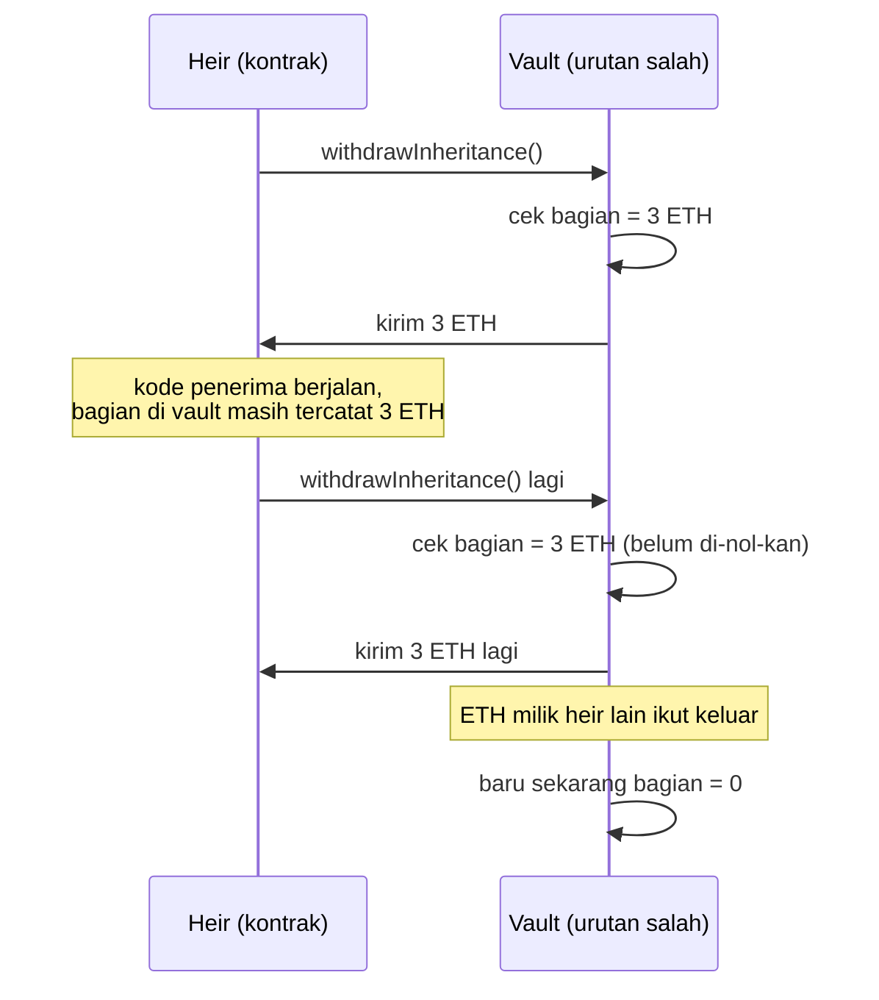
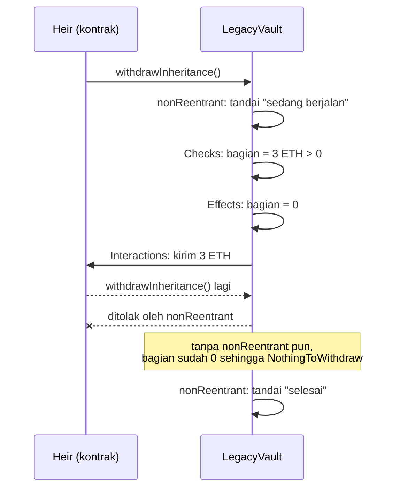
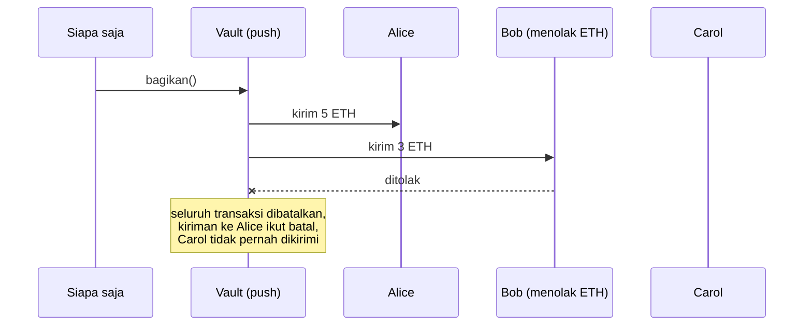
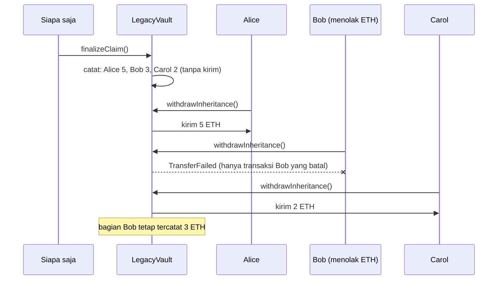

# Penjelasan Proyek LegacyVault

Dokumen ini ditulis untuk pemilik proyek yang baru mengenal Web3. Setiap tahap pengerjaan menambah satu bagian baru di sini.

---

## Tahap 0: Persiapan proyek

### 1. Apa yang dibuat di tahap ini

Belum ada smart contract yang ditulis. Tahap ini hanya menyiapkan alat kerja:

- **Foundry** dipasang di komputer (versi 1.9.0). Isinya `forge`, `anvil`, `cast`, dan `chisel`.
- Folder ini dijadikan proyek Foundry. Strukturnya:
  - `src/`: tempat kode smart contract (`.sol`) nanti.
  - `test/`: tempat kode pengujian.
  - `script/`: tempat skrip deploy.
  - `lib/`: pustaka dari pihak lain. Isinya `forge-std` (alat bantu test bawaan Foundry) dan `openzeppelin-contracts` versi 5.7.0.
  - `foundry.toml`: file pengaturan proyek.
- Versi compiler Solidity dikunci ke **0.8.28** di `foundry.toml`.
- Proyek dijadikan repositori Git, dan `.gitignore` disiapkan supaya file rahasia (`.env`) dan file hasil build tidak ikut tersimpan.
- File contoh `Counter` bawaan Foundry dihapus karena tidak dipakai.

### 2. Konsep yang dipakai

**Smart contract.** Program kecil yang disimpan dan dijalankan di blockchain. Begitu dipasang, kodenya tidak bisa diubah diam-diam, dan siapa pun bisa melihat apa yang dikerjakannya. Analoginya mesin penjual otomatis: aturannya sudah tertanam di mesin, tidak perlu penjaga toko.

**Solidity.** Bahasa pemrograman untuk menulis smart contract di Ethereum. Kode Solidity harus di-*compile* (diterjemahkan) dulu menjadi *bytecode* yang dimengerti blockchain.

**Foundry.** Satu paket alat untuk membuat, menguji, dan memasang smart contract. Analoginya kotak perkakas tukang: satu kotak berisi beberapa alat dengan fungsi berbeda.

- **forge**: alat utama. `forge build` meng-compile kode Solidity, `forge test` menjalankan pengujian. Test di Foundry juga ditulis dalam Solidity, jadi tidak perlu belajar bahasa kedua.
- **anvil**: blockchain Ethereum tiruan yang berjalan di komputer sendiri. Saat dinyalakan, anvil langsung menyediakan 10 akun yang masing-masing berisi 10.000 ETH palsu.
- **cast**: alat baris perintah untuk "mengobrol" dengan blockchain, misalnya mengecek saldo atau memanggil fungsi kontrak tanpa membuat UI.
- **chisel**: tempat mencoba potongan kode Solidity secara cepat. Jarang dipakai di proyek ini.

**OpenZeppelin Contracts.** Kumpulan kode smart contract yang sudah diaudit dan dipakai luas. Proyek ini hanya mengambil satu bagian, `ReentrancyGuard`, yaitu pengaman terhadap serangan *reentrancy*. Serangan itu akan dijelaskan di tahap berikutnya. Analoginya membeli kunci pintu bersertifikat daripada membuat kunci sendiri.

**Mengunci versi compiler.** Versi Solidity yang berbeda bisa menghasilkan bytecode yang sedikit berbeda, dan kadang ada perbaikan bug di antara versi. Dengan mengunci ke 0.8.28, siapa pun yang menjalankan `forge build` (dosen, teman, atau server) mendapat hasil yang sama.

**Kenapa menguji di blockchain lokal dulu?**

1. **Gratis.** Setiap transaksi di jaringan Ethereum asli membayar biaya (*gas*) dengan ETH sungguhan. Di anvil, ETH-nya palsu.
2. **Cepat.** Di jaringan asli, transaksi menunggu belasan detik untuk masuk blok. Di anvil, langsung.
3. **Bisa memutar waktu.** Kontrak ini bergantung pada waktu ("pemilik tidak aktif selama periode tertentu", misalnya 180 hari). Di jaringan asli kita harus benar-benar menunggu. Di Foundry, `vm.warp` bisa melompatkan waktu dalam sekejap.
4. **Kesalahan tidak permanen.** Kontrak yang sudah terpasang di jaringan asli tidak bisa diperbaiki. Jika ada bug yang membuat ETH terkunci, ETH itu hilang selamanya. Di lokal, cukup matikan anvil dan mulai lagi.

Analoginya simulator mengemudi: berlatih menabrak di simulator jauh lebih murah daripada di jalan raya.

### 3. Pertanyaan 

**T: Kenapa memakai Foundry, bukan Hardhat atau Remix?**
J: Remix berjalan di browser dan cocok untuk mencoba, tetapi kurang cocok untuk proyek dengan banyak test. Hardhat menulis test dalam JavaScript, sedangkan Foundry menulis test dalam Solidity, bahasa yang sama dengan kontraknya. Foundry juga menyediakan fuzz testing (menguji dengan ribuan input acak) secara bawaan, dan itu dipakai untuk memeriksa perhitungan pembagian warisan.

**T: Apa bedanya anvil dengan testnet seperti Sepolia?**
J: Anvil hanya berjalan di komputer sendiri dan hilang saat dimatikan. Sepolia adalah jaringan publik yang mirip Ethereum asli, tetapi ETH-nya tidak bernilai. Anvil dipakai untuk pengembangan dan pengujian sehari-hari karena cepat dan bisa dikendalikan penuh, termasuk waktunya.

**T: Kenapa hanya memakai `ReentrancyGuard` dari OpenZeppelin, tidak lebih?**
J: Supaya kode tetap sederhana dan bisa dipahami sendiri. Bagian lain, seperti aturan peran pemilik, ahli waris, dan guardian, ditulis langsung karena kebutuhannya spesifik dan lebih mudah dijelaskan. `ReentrancyGuard` diambil karena ini pengaman keamanan yang sudah teruji, dan membuatnya sendiri justru berisiko.

**T: Kenapa file `.env` tidak di-commit?**
J: File `.env` biasanya berisi private key. Siapa pun yang memegang private key bisa memindahkan seluruh isi akun tersebut. Jika file itu masuk Git dan diunggah ke GitHub, kunci itu bisa dibaca orang lain.

**T: Kenapa versi Solidity 0.8.x?**
J: Mulai versi 0.8.0, Solidity otomatis menolak operasi aritmetika yang meluap (*overflow*), misalnya angka yang melewati batas maksimum lalu berputar menjadi kecil. Di versi lama, ini sumber banyak bug dan pencurian dana. 0.8.28 dipilih karena stabil dan didukung OpenZeppelin 5.7.0 (yang membutuhkan minimal 0.8.20).

---

## Tahap 1: Smart contract LegacyVault

### 1. Apa yang dibuat di tahap ini

File `src/LegacyVault.sol`, yaitu smart contract brankas ETH yang bisa diwariskan, sesuai SPEC.md bagian 2 sampai 5. Isinya:

- **Tiga peran:** owner (pemilik), heir (ahli waris, maksimal 10), dan guardian (pihak tepercaya penyetuju klaim, maksimal 10).
- **Fungsi owner:** `deposit`, `withdraw`, `checkIn`, `updateHeirs`, `cancelClaim`.
- **Alur klaim warisan:** `startClaim`, lalu `approveClaim`, lalu `finalizeClaim`, lalu setiap heir memanggil `withdrawInheritance`.
- **`getStatus`:** mengembalikan ringkasan status dalam satu panggilan untuk UI nanti.
- **Validasi lengkap** saat deploy dan saat daftar ahli waris diganti: tidak boleh alamat kosong, tidak boleh duplikat, owner tidak boleh punya peran lain, guardian tidak boleh sekaligus heir, dan total porsi harus tepat 100%.

Hasil `forge build`: "Compiler run successful!" tanpa warning. Test lengkap untuk setiap fungsi dibuat di tahap berikutnya.

### 2. Konsep yang dipakai

**State machine (mesin status).** Vault selalu berada di salah satu dari tiga keadaan, dan setiap fungsi hanya boleh dipanggil di keadaan tertentu.

```
            startClaim                finalizeClaim
  Active  ------------->  Claiming  ---------------->  Distributed
    ^                        |
    |      cancelClaim       |
    +------------------------+
```

- **Active:** pemilik dianggap masih ada. Ia bebas menyetor, menarik, dan mengganti ahli waris.
- **Claiming:** ada klaim warisan yang sedang berjalan. Uang belum bisa ditarik siapa pun. Pemilik masih bisa membatalkan.
- **Distributed:** final, tidak bisa kembali. Bagian setiap ahli waris sudah dihitung dan tinggal diambil.

Analoginya lampu lalu lintas: dari hijau ke kuning ke merah, dengan urutan yang sudah ditentukan. Di kode, aturan ini dijaga oleh modifier `inState(...)`. Contohnya, `withdraw` memakai `inState(State.Active)`, sehingga owner tidak bisa menarik dana diam-diam saat klaim sedang berjalan.

**Check-in (tanda masih hidup).** Setiap kali owner melakukan sesuatu (setor, tarik, ganti ahli waris, atau sekadar `checkIn`), kontrak mencatat waktunya di `lastCheckIn`. Klaim baru boleh dimulai jika sudah lewat `inactivityPeriod` sejak check-in terakhir. Analoginya penjaga yang bertanya "masih ada orang di rumah?" secara berkala.

**Kenapa persetujuan terikat `claimId`?** Bayangkan urutan kejadian ini tanpa `claimId`:
1. Klaim dimulai. Guardian A menyetujui.
2. Pemilik ternyata masih hidup dan membatalkan klaim.
3. Setahun kemudian ada klaim baru. Persetujuan A dari klaim lama masih tercatat, padahal A belum tentu setuju dengan klaim yang baru.

Untuk mencegah ini, setiap klaim diberi nomor (`claimId`) yang naik setiap kali `startClaim` dipanggil. Persetujuan disimpan sebagai `hasApproved[nomorKlaim][guardian]`. Klaim baru punya nomor baru, jadi kolom persetujuannya otomatis kosong. Persetujuan lama tidak perlu dihapus satu per satu. Data itu tetap ada, tetapi tidak pernah dibaca lagi. Analoginya formulir bernomor: tanda tangan di formulir nomor 1 tidak berlaku untuk formulir nomor 2.

**Basis point.** Porsi warisan ditulis dalam basis point (bps): 10000 bps = 100%, jadi 1 bps = 0,01%. Solidity tidak punya bilangan desimal, sehingga porsi seperti 33,33% ditulis 3333. Pembagian bilangan bulat selalu membulatkan ke bawah, dan sisa beberapa wei hasil pembulatan diberikan ke heir terakhir. Hasilnya, tidak ada ETH yang tertinggal terkunci di kontrak.

**Pull payment (ambil sendiri).** `finalizeClaim` tidak mengirim ETH ke siapa pun. Fungsi ini hanya mencatat bagian setiap heir. Setiap heir lalu mengambil sendiri lewat `withdrawInheritance`. Jika kontrak mengirim ke semua heir sekaligus dalam satu loop, satu heir yang alamatnya menolak ETH akan membuat seluruh pembagian gagal, dan heir lain ikut tidak dapat apa-apa. Analoginya bank yang menyiapkan amplop atas nama masing-masing, lalu setiap orang datang mengambil amplopnya sendiri.

**Checks-Effects-Interactions dan reentrancy.** Urutan di `withdrawInheritance`:
1. **Checks:** periksa apakah bagiannya lebih dari 0.
2. **Effects:** ubah catatan bagiannya menjadi 0.
3. **Interactions:** baru kirim ETH.

Kenapa catatan di-nol-kan sebelum mengirim? Penerima ETH bisa berupa smart contract yang, begitu menerima uang, langsung memanggil `withdrawInheritance` lagi (*reentrancy*). Jika catatannya belum di-nol-kan, ia bisa menarik berkali-kali. Analoginya kasir yang mencoret nama di daftar sebelum menyerahkan uang, bukan sesudahnya. Sebagai lapisan kedua, fungsi ini juga memakai `nonReentrant` dari OpenZeppelin, yang menolak panggilan ulang selama fungsi masih berjalan.

**Custom error.** Saat transaksi gagal, kontrak mengembalikan error bernama, misalnya `OwnerStillActive(activeUntil)`, bukan kalimat panjang. Biayanya lebih murah, dan UI bisa membaca datanya. Contohnya UI bisa menampilkan "klaim baru bisa dimulai tanggal sekian".

**Linter.** Forge versi 1.x punya pemeriksa gaya kode (linter) yang memberi peringatan untuk pola yang sering berbahaya. Ada empat jenis peringatan yang muncul, dan semuanya sudah ditangani:
- **Kirim ETH ke alamat yang ditentukan pengguna:** kode diatur ulang supaya terlihat jelas bahwa ETH hanya dikirim ke owner, atau ke heir yang memanggil sendiri.
- **`revert` di dalam loop:** disengaja. Satu alamat yang tidak valid memang harus membatalkan seluruh daftar.
- **Pemakaian `block.timestamp`:** disengaja. Validator hanya bisa menggeser waktu blok beberapa detik, sedangkan periode di kontrak ini minimal 1 hari.
- **Perubahan `isHeir` tanpa event:** salah deteksi. Event `HeirsUpdated` sebenarnya dipancarkan di akhir fungsi yang sama.

Untuk tiga yang terakhir, peringatan dimatikan hanya di baris atau fungsi itu dengan komentar `// forge-lint: disable-...`, dan alasannya ditulis di sebelahnya.

### 3. Pertanyaan 

**T: Bagaimana kontrak tahu pemiliknya sudah meninggal?**
J: Tidak tahu. Kontrak hanya tahu pemilik tidak melakukan apa pun selama `inactivityPeriod`. Karena itu ada tiga lapisan pengaman: persetujuan guardian, masa tunggu (timelock), dan hak pemilik untuk membatalkan klaim selama masa tunggu.

**T: Apa yang terjadi kalau pemilik ternyata masih hidup ketika klaim berjalan?**
J: Pemilik memanggil `cancelClaim`. Vault kembali ke Active, waktu check-in diperbarui, dan semua persetujuan klaim itu tidak berlaku lagi karena klaim berikutnya memakai `claimId` baru.

**T: Kenapa guardian tidak boleh sekaligus ahli waris?**
J: Konflik kepentingan. Orang yang diuntungkan oleh klaim tidak boleh menjadi orang yang menyetujui klaim tersebut.

**T: Kenapa `finalizeClaim` boleh dipanggil siapa saja?**
J: Karena semua syaratnya diperiksa di dalam fungsi: persetujuan cukup dan masa tunggu sudah lewat. Siapa pun yang memanggil, hasilnya sama. Ini mencegah dana tertahan hanya karena satu orang tertentu tidak mau atau tidak bisa memanggilnya.

**T: Kenapa memakai `call` untuk mengirim ETH, bukan `transfer`?**
J: `transfer` hanya memberi penerima 2300 gas. Penerima berupa smart contract wallet (misalnya multisig) bisa butuh lebih dari itu, sehingga `transfer` gagal. `call` meneruskan gas yang cukup. Karena `call` tidak otomatis membatalkan transaksi saat gagal, hasilnya dicek manual dengan `if (!success) revert TransferFailed();`. Risiko reentrancy dari `call` ditutup oleh Checks-Effects-Interactions dan `nonReentrant`.

**T: Kenapa jumlah ahli waris dan guardian dibatasi 10?**
J: `finalizeClaim` dan `updateHeirs` memakai loop sepanjang daftar. Setiap putaran memakan gas, dan satu blok punya batas gas. Jika daftarnya tidak dibatasi, loop bisa terlalu mahal dan fungsi tidak bisa dipanggil sama sekali, sehingga dana terkunci.

**T: Kenapa sisa pembulatan diberikan ke heir terakhir?**
J: Contohnya, 1 ETH ditambah 1 wei dibagi 3333/3333/3334 bps tidak habis dibagi. Tanpa aturan ini, sisa beberapa wei akan tertinggal di kontrak selamanya. Memberikannya ke heir terakhir menjamin jumlah semua bagian tepat sama dengan saldo yang dibagi.

---

## Tahap 2: Pengujian

### 1. Apa yang dibuat di tahap ini

- `test/LegacyVault.t.sol` berisi **92 test**, dan semuanya lolos: `92 tests passed, 0 failed, 0 skipped`. Kelompok test-nya:
  - **Constructor (23 test):** konfigurasi valid, batas tepat 10 heir/guardian dan periode tepat 1 hari, plus setiap aturan validasi yang dilanggar. Contohnya total porsi 9999 dan 10001, alamat nol, duplikat, owner sebagai heir/guardian, guardian sebagai heir, threshold 0 atau melebihi jumlah guardian, 11 heir, 11 guardian, periode 1 hari kurang 1 detik.
  - **Fase Active (27 test):** `deposit`, `receive`, `withdraw`, `checkIn`, dan `updateHeirs`. Setiap fungsi dicoba oleh peran yang benar dan yang salah, serta di state yang salah. Ada juga satu fuzz test yang mencoba 1000 alamat acak bukan-owner terhadap semua fungsi owner.
  - **Klaim (21 test):** klaim terlalu cepat, guardian menyetujui dua kali, bukan-guardian menyetujui, finalize sebelum threshold, dan finalize sebelum timelock (tepat 1 detik sebelum `unlockTime`).
  - **Pembatalan (7 test):** termasuk skenario approve, lalu cancel, lalu klaim baru, dan persetujuan lama tidak terhitung.
  - **Pencairan (11 test):** bagian setiap heir tepat, sisa pembulatan jatuh ke heir terakhir, tidak bisa menarik dua kali, bukan-heir ditolak, setoran setelah Distributed ditolak, dan heir yang menolak ETH tidak mengganggu heir lain.
  - **`getStatus`:** satu test yang memeriksa isinya di ketiga state.
  - **Fuzz pembagian warisan:** 1000 kombinasi acak saldo (0 sampai 1 miliar ETH), jumlah heir (1 sampai 10), dan porsi.
  - **End-to-end:** dari setoran sampai semua heir menarik.
- Output asli `forge test -vv` disimpan di `docs/test-output.txt`, dan output `forge test --gas-report` di `docs/gas-report.txt`.
- `foundry.toml` mendapat pengaturan `[fuzz] runs = 1000`. Bawaan Foundry hanya 256 run.

**Apakah ada bug yang ditemukan?** Tidak ada bug di kontrak. Semua test lolos sejak run pertama. Ada dua perbaikan, keduanya di file test, bukan di kontrak:
1. Satu baris test tidak bisa di-compile. Penyebabnya, `((1 ether + 7) * 3333) / 10000` dihitung compiler sebagai pecahan, bukan bilangan bulat. Perbaikannya, angkanya disimpan dulu di variabel.
2. Linter memperingatkan pemakaian `block.timestamp` setelah `vm.warp`. Pada mode compiler tertentu, nilai itu bisa "basi" (masih nilai lama), sehingga test membaca waktu yang salah. Semua pemakaiannya di test diganti dengan `vm.getBlockTimestamp()`, cara yang dianjurkan Foundry.

**Bukti bahwa test-nya tidak asal hijau.** Test yang langsung lolos bisa saja test yang lemah. Untuk mengujinya, kontrak sengaja dirusak di tiga tempat, satu per satu. Setiap kali, test dijalankan ulang, lalu kontraknya dikembalikan:

| Kerusakan yang disengaja | Test yang gagal |
|---|---|
| Sisa pembulatan tidak diberikan ke heir terakhir | Fuzz test pembagian (menemukan selisih 1 wei) dan test pembulatan |
| Hitungan persetujuan tidak di-reset saat klaim baru atau cancel | Dua test pembatalan |
| Bagian heir tidak di-nol-kan sebelum ETH dikirim | Test tarik dua kali dan test bagian setiap heir |

Ketiga kerusakan itu tertangkap. Artinya, test benar-benar menjaga aturan penting di SPEC.

**Sebagian angka gas dari `docs/gas-report.txt`.** Angka ini diukur di lingkungan test, jadi biaya di jaringan asli bisa sedikit berbeda.

| Fungsi | Median gas | Maksimum gas |
|---|---|---|
| Deploy kontrak | 2.961.888 (satu kali) | |
| `deposit` | 25.136 | 31.354 |
| `startClaim` | 78.865 | 78.865 |
| `approveClaim` | 75.136 | 82.094 |
| `finalizeClaim` | 173.816 | 333.016 (10 heir) |
| `withdrawInheritance` | 45.118 | 45.118 |

Angka "Min" di laporan biasanya berasal dari panggilan yang gagal (revert di awal), jadi tidak mewakili biaya normal.

### 2. Konsep yang dipakai

**Unit test.** Program kecil yang memanggil kontrak lalu memeriksa hasilnya. Contohnya: "setelah alice menarik, saldo alice harus 5 ETH". Jika ada yang tidak sesuai, test gagal dan menunjukkan baris mana yang salah. Analoginya daftar periksa inspeksi kendaraan: setiap butir diperiksa satu per satu, dan satu butir yang gagal membuat kendaraan tidak lulus.

**Jalur berhasil dan jalur gagal.** Setiap fungsi diuji dua arah: bahwa ia bekerja untuk orang yang berhak, dan bahwa ia **menolak** orang yang tidak berhak dengan error yang tepat. Untuk smart contract, jalur gagal sama pentingnya, karena penyerang selalu mencoba memanggil fungsi yang bukan haknya.

**Alat bantu Foundry (cheatcode).** Test di Foundry bisa memanipulasi blockchain tiruan:
- `vm.prank(alamat)`: panggilan berikutnya dianggap datang dari alamat itu. Dengan ini satu test bisa memerankan owner, heir, guardian, atau orang asing.
- `vm.warp(waktu)`: melompatkan jam blockchain. Masa tidak aktif 180 hari bisa diuji dalam sekejap.
- `vm.expectRevert(error)`: menyatakan bahwa panggilan berikutnya **harus** gagal dengan error tertentu. Jika ternyata berhasil, atau gagal dengan error lain, test-nya yang gagal.
- `vm.expectEmit`: memeriksa bahwa event yang benar dipancarkan.
- `vm.deal(alamat, jumlah)`: mengisi saldo ETH palsu.

**Uji batas (boundary).** Banyak bug muncul tepat di batas, misalnya `<` yang seharusnya `<=`. Karena itu test memeriksa nilai di sekitar batas: klaim 1 detik sebelum masa tidak aktif habis harus gagal, klaim tepat saat batas harus berhasil, finalize 1 detik sebelum `unlockTime` harus gagal, dan 10 heir diterima sedangkan 11 ditolak.

**Fuzz test.** Biasanya test memakai angka yang kita pilih sendiri. Fuzz test membiarkan Foundry memilih angka acak ribuan kali. Di sini Foundry mencoba 1000 kombinasi saldo, jumlah heir, dan porsi, lalu setiap kali memeriksa dua hal:
1. Total yang ditarik semua heir tidak pernah melebihi snapshot (invariant 1).
2. Setelah semua heir menarik, totalnya tepat sama dengan snapshot dan saldo kontrak 0 (invariant 2).

Analoginya menguji timbangan dengan seribu barang berbeda, bukan hanya dengan satu batu yang beratnya sudah kita tahu.

**Kontrak penolak ETH.** Test memakai dua kontrak kecil, `RejectingHeir` dan `RejectingOwner`, yang sengaja tidak bisa menerima ETH. Keduanya membuktikan dua hal:
- Kontrak memeriksa hasil `call` dan mengembalikan error `TransferFailed`, bukan diam-diam menganggap pengiriman berhasil.
- Berkat pull payment, satu heir yang bermasalah tidak menghalangi heir lain menarik bagiannya.

**Laporan gas.** Setiap operasi di Ethereum memakan *gas*, satuan kerja komputasi yang dibayar dengan ETH. Laporan gas menunjukkan biaya setiap fungsi. Contohnya, `finalizeClaim` paling mahal karena harus menghitung bagian untuk setiap heir dalam loop. Biayanya naik seiring jumlah heir, dan itulah alasan jumlah heir dibatasi 10.

### 3. Pertanyaan 

**T: Bagaimana Anda tahu test-nya cukup?**
J: Dengan tiga cara. Pertama, setiap fungsi publik punya test jalur berhasil dan jalur gagal. Kedua, nilai di sekitar batas diuji. Ketiga, kontrak sengaja dirusak di tiga tempat penting, dan test langsung gagal setiap kali. Test yang tetap hijau ketika kodenya rusak tidak ada gunanya.

**T: Apa bedanya fuzz test dengan unit test biasa?**
J: Unit test memakai contoh yang kita pilih, misalnya 10 ETH dibagi 50/30/20. Fuzz test memakai ribuan input acak, sehingga bisa menemukan kasus yang tidak terpikirkan, seperti saldo yang menghasilkan sisa pembulatan 1 wei. Ini terbukti saat percobaan merusak kontrak: fuzz test-lah yang menemukan selisih 1 wei.

**T: Kenapa test memeriksa jenis error, bukan sekadar "transaksi gagal"?**
J: Transaksi bisa gagal karena alasan yang salah. Contohnya, test "bukan-guardian tidak boleh menyetujui" bisa saja lolos karena state-nya keliru, bukan karena pemeriksaan perannya bekerja. Dengan mencocokkan error yang tepat (`NotGuardian`), kita tahu pengaman yang dimaksud benar-benar bekerja.

**T: Kenapa ada test "heir tetap boleh berada di daftar baru saat `updateHeirs`"?**
J: Kontrak mendeteksi duplikat dengan tanda `isHeir`. Jika tanda lama lupa dihapus sebelum daftar baru dipasang, heir yang dipertahankan akan dianggap duplikat, dan owner tidak bisa sekadar mengubah porsi. Test ini menjaga agar urutan "hapus tanda lama, lalu pasang daftar baru" tidak rusak di kemudian hari.

**T: Apakah angka gas di laporan sama dengan biaya di Ethereum asli?**
J: Mendekati, tetapi tidak persis. Laporan gas mengukur jumlah unit gas. Biaya dalam rupiah tergantung harga gas saat itu dan harga ETH. Laporan ini berguna untuk membandingkan fungsi mana yang mahal, bukan untuk menghitung tagihan pasti.

---

## Tahap 3: Bukti mitigasi keamanan

### 1. Apa yang dibuat di tahap ini

- **`test/security/LegacyVault.security.t.sol`:** 34 test keamanan, dikelompokkan per baris tabel ancaman di SPEC.md bagian 7. Setiap kelompok diawali komentar yang menyebut ancaman dan mitigasinya. 33 test dipindahkan apa adanya dari file test tahap 2 (dengan skrip, bukan diketik ulang), dan 1 test baru ditambahkan: `updateHeirs` menolak 11 heir.
- **`test/utils/LegacyVaultFixture.sol`:** konfigurasi dan helper bersama, supaya file test utama dan file test keamanan memakai `setUp` yang sama.
- **`test/LegacyVault.t.sol`:** sekarang berisi 59 test fungsional.

  Total test menjadi 93 (59 + 34), semuanya lolos. Output asli test keamanan ada di `docs/security-output.txt`.
- **`docs/MUTATION.md`:** hasil uji perusakan untuk 22 mutasi, satu atau lebih per mitigasi. Output asli setiap mutasi ada di `docs/mutation/M01.txt` sampai `M22.txt`. Semua mutasi dijalankan di branch sementara yang lalu dihapus, dan kode yang dirusak tidak pernah di-commit.

**Hasil uji perusakan:**
- 19 dari 22 mutasi tertangkap oleh test keamanan.
- 1 mutasi (M16) hanya tertangkap oleh test fungsional, dan memang tidak berdampak pada keamanan.
- **2 mutasi tidak tertangkap test mana pun:** membalik urutan Checks-Effects-Interactions (M02) dan menghapus `nonReentrant` (M03).

Penyebab M02 dan M03 lolos dijelaskan di bawah. Ini batasan yang perlu Anda ketahui dan bisa Anda sampaikan ke dosen.

### 2. Konsep yang dipakai

#### Reentrancy (masuk ulang)

Saat kontrak mengirim ETH ke sebuah alamat, dan alamat itu ternyata smart contract, kontrak penerima boleh menjalankan kodenya sendiri **di tengah-tengah** proses pengiriman. Kode itu bisa memanggil balik kontrak pengirim sebelum fungsi pertama selesai. Itulah *reentrancy*.

Bahayanya muncul jika kontrak pengirim **mengirim dulu, baru mencatat**. Diagram berikut menggambarkan versi yang salah (urutan terbalik). Versi ini **tidak** dipakai di LegacyVault.



Urutan di LegacyVault, yang memakai Checks-Effects-Interactions dan `nonReentrant`:



**Analogi.** Kasir bank memegang daftar nama dan jumlah uang yang boleh diambil.
- Kasir yang ceroboh menyerahkan uang dulu, baru mencoret nama. Selama kasir masih sibuk menghitung uang di meja, orang yang sama bisa menyerobot antrean dan meminta lagi, dan namanya masih belum dicoret.
- Kasir yang benar mencoret nama **sebelum** menyerahkan uang (Checks-Effects-Interactions), dan menutup loket selama satu transaksi berjalan (`nonReentrant`).

**Kenapa uji perusakan tidak menangkap M02 dan M03?** Di test, penerima ETH adalah alamat biasa yang tidak menjalankan kode saat menerima ETH. Dalam kondisi itu, urutan "kirim dulu" atau "catat dulu" memberi hasil yang sama, karena tidak ada yang menyerobot. Test membuktikan bahwa bagian heir di-nol-kan dan tidak bisa ditarik dua kali secara berurutan, tetapi tidak bisa membuktikan perlindungan terhadap panggilan ulang di tengah pengiriman. Itu sebabnya ada **dua lapisan**:
- Jika urutannya terbalik tetapi `nonReentrant` ada, panggilan ulang tetap ditolak.
- Jika `nonReentrant` hilang tetapi urutannya benar, panggilan ulang menemukan bagian yang sudah 0.

Kontrak baru rentan jika keduanya rusak sekaligus. Untuk dua baris ini, pengamannya adalah tinjauan kode dan komentar di atas fungsi `withdrawInheritance`.

#### DoS (Denial of Service) karena push payment

*Push payment* berarti kontrak mengirim ETH ke semua penerima dalam satu loop. Jika satu pengiriman gagal dan kontrak membatalkan transaksi, **seluruh** loop ikut batal. Satu heir yang alamatnya menolak ETH, baik sengaja maupun karena wallet-nya bermasalah, membuat tidak ada seorang pun yang menerima warisan. Pembagian itu tidak akan pernah berhasil, berapa kali pun dicoba.

Diagram berikut menggambarkan desain push. Desain ini **tidak** dipakai di LegacyVault.



Desain LegacyVault, dengan pull payment:



**Analogi.**
- Push payment seperti kurir yang membawa tiga paket dalam satu perjalanan, dengan aturan "kalau satu paket ditolak, semua paket dibawa pulang". Satu penerima yang tidak mau membuka pintu membuat dua penerima lain tidak dapat paket.
- Pull payment seperti loket pengambilan: paket disiapkan atas nama masing-masing, dan setiap orang datang mengambil sendiri. Satu orang yang tidak datang tidak mengganggu orang lain.

Test `test_RevertWhen_HeirRejectsEth_OtherHeirsUnaffected` membuktikan hal ini. Mutasi M04 juga menunjukkan kenapa hasil `call` wajib dicek: tanpa pemeriksaan itu, bagian Bob akan di-nol-kan padahal ETH-nya tidak pernah sampai.

#### Uji perusakan (mutation check)

Caranya, kontrak sengaja dirusak satu baris, lalu test dijalankan. Jika test gagal, test itu terbukti menjaga baris tersebut. Jika test tetap hijau, ada celah, dan celah itu harus dicatat dengan jujur, seperti M02 dan M03. Analoginya menguji alarm rumah dengan sengaja membuka jendela: alarm yang tidak berbunyi berarti ada jendela yang tidak dijaga.

### 3. Pertanyaan 

**T: Kenapa tidak membuat kontrak penyerang untuk membuktikan perlindungan reentrancy?**
J: Proyek ini sengaja tidak memuat kode penyerang. Sebagai gantinya, perlindungan dibuktikan dengan tiga cara. Pertama, test menunjukkan bagian heir di-nol-kan dan tidak bisa ditarik dua kali. Kedua, kontrak memakai dua lapisan yang saling menutupi (CEI dan `nonReentrant`). Ketiga, uji perusakan dilaporkan apa adanya: dua mutasi itu tidak tertangkap, beserta alasannya.

**T: Jika sudah ada `nonReentrant`, kenapa masih perlu Checks-Effects-Interactions?**
J: Pertahanan berlapis. `nonReentrant` hanya melindungi fungsi yang memakainya. CEI adalah kebiasaan menulis kode yang tetap aman walaupun suatu hari modifier itu terhapus atau ada fungsi baru yang lupa diberi modifier. Uji perusakan menunjukkan bahwa menghapus salah satu lapisan saja tidak langsung membuat kontrak rentan.

**T: Kenapa M16 tidak dianggap celah keamanan?**
J: Hitungan persetujuan juga di-reset di `startClaim`, dan klaim baru adalah satu-satunya jalan menuju pencairan. Jadi angka lama hanya terlihat di `getStatus()` selama vault kembali Active, dan tidak bisa dipakai untuk mencairkan dana. Test fungsional tetap menangkapnya supaya tampilan UI tidak menyesatkan.

**T: Apa yang terjadi pada bagian heir yang alamatnya menolak ETH?**
J: Bagiannya tetap tercatat di `inheritanceOf` dan tidak hilang. ETH-nya tertahan di kontrak sampai alamat itu bisa menerima ETH. Jika alamat itu tidak akan pernah bisa menerima ETH, bagian itu terkunci. Ini risiko yang ditanggung heir tersebut sendiri, bukan heir lain.

**T: Bagaimana jika pemilik lupa check-in dan klaim sudah disetujui guardian?**
J: Pemilik masih punya waktu sepanjang timelock (7 hari dalam konfigurasi test) untuk memanggil `cancelClaim`. Test `test_CancelClaim_DuringTimelockBlocksFinalize` membuktikan bahwa setelah pembatalan, klaim tidak bisa difinalisasi, dan klaim baru juga tidak bisa langsung dimulai karena pembatalan dihitung sebagai check-in.

---

## Tahap 4: Skrip deploy

### 1. Apa yang dibuat di tahap ini

| File | Fungsi |
|---|---|
| `script/Deploy.s.sol` | Deploy LegacyVault dengan konfigurasi dari environment variable (file `.env`). Bisa untuk Anvil maupun Sepolia. |
| `script/SeedDemo.s.sol` | Khusus Anvil. Deploy vault dengan tokoh demo, lalu Pak Icanov menyetor 10 ETH. |
| `script/AnvilAccounts.sol` | Daftar 10 alamat akun bawaan Anvil, dipakai bersama oleh kedua skrip. |
| `script/export-contract.mjs` | Menyalin alamat kontrak dan ABI ke `ui/src/contract.json` setelah deploy lokal. |
| `package.json` | Perintah `npm run anvil`, `npm run deploy-local`, `npm run seed`. |
| `.env.example` | Contoh isi `.env`, tanpa rahasia. |
| `docs/DEPLOY.md` | Panduan lengkap deploy lokal dan Sepolia. |
| `test/script/Scripts.t.sol` | 7 test untuk kedua skrip. |
| `foundry.toml` | Ditambah `[rpc_endpoints]` dan `[etherscan]` untuk Sepolia. Nilainya diambil dari `.env`. |

Tokoh demo yang dibuat `npm run seed`:

| Akun Anvil | Tokoh | Peran |
|---|---|---|
| 0 | Pak Icanov | Owner, menyetor 10 ETH |
| 1 | Mas Kevin | Heir 60% |
| 2 | Mas Murni | Heir 40% |
| 3 | Mas Barrok | Guardian |
| 4 | Notaris Budi | Guardian |
| 5 | Pak RT Wowo | Guardian |

Konfigurasinya: threshold 2, masa tidak aktif 180 hari, timelock 7 hari.

**Keputusan yang perlu Anda ketahui:**
- **`package.json`, bukan `Makefile`.** Program `make` tidak terpasang di Windows Anda, sedangkan Node.js sudah ada. Jadi perintahnya `npm run anvil`, `npm run deploy-local`, dan `npm run seed`.
- **Tidak ada private key akun Anvil di repo.** Anvil "membuka" akun-akun bawaannya, sehingga forge bisa mengirim transaksi atas nama akun itu cukup dengan menyebut alamatnya (`--unlocked --sender`), tanpa private key.
- **`npm run seed` men-deploy vault demo sendiri,** tidak memakai vault dari `deploy-local`. Untuk demo, cukup jalankan `npm run anvil` lalu `npm run seed`, tanpa perlu membuat `.env`.
- **`Deploy.s.sol` menolak akun Anvil di luar jaringan lokal.** Jika chainId bukan 31337 dan owner, heir, atau guardian masih memakai alamat akun Anvil, deploy dibatalkan dengan error `AnvilAccountOnPublicChain`. Ini mencegah kesalahan menyalin `.env.example` apa adanya ke Sepolia.
- **Deploy ke Sepolia belum dijalankan.** Panduannya ada di `docs/DEPLOY.md`.

**Yang sudah diuji sungguhan di Anvil, bukan hanya di test:**
1. `npm run anvil`: 10 alamat akun yang dicetak Anvil sama persis dengan isi `script/AnvilAccounts.sol`.
2. `npm run seed`: vault demo berada di `0x5FbDB2315678afecb367f032d93F642f64180aa3`, dan `cast` membaca saldo 10 ETH, owner Pak Icanov, heir pertama Mas Kevin dengan porsi 6000, threshold 2, state Active.
3. `npm run deploy-local` dengan `.env` hasil salinan `.env.example`: berhasil.
4. Mas Kevin mencoba `startClaim` dengan `cast send`. Sebelum waktu dimajukan, klaim ditolak dengan error `OwnerStillActive`. Setelah `evm_increaseTime` 180 hari, klaim berhasil, state menjadi Claiming, dan `claimId` menjadi 1.

Total test sekarang 100 (59 fungsional, 34 keamanan, 7 skrip), semuanya lolos.

### 2. Konsep yang dipakai

**Deploy.** Memasang kontrak ke blockchain. Secara teknis, deploy adalah transaksi khusus yang berisi bytecode kontrak dan argumen constructor. Setelah transaksi itu masuk blok, kontrak punya alamat sendiri dan kodenya tidak bisa diubah lagi. Analoginya mencetak buku: setelah naik cetak, isinya tidak bisa diedit, dan kalau ada salah, harus terbit edisi baru di alamat baru.

**Skrip forge (`forge script`).** Program Solidity yang menjalankan langkah-langkah deploy. Forge selalu menjalankan skrip sebagai simulasi lebih dulu. Hanya dengan tanda `--broadcast` transaksinya benar-benar dikirim ke jaringan. Analoginya gladi resik sebelum acara sungguhan.

**Environment variable dan `.env`.** Konfigurasi (siapa heir, berapa porsinya) dan rahasia (private key) disimpan di luar kode, di file `.env` yang tidak masuk Git. Kode yang sama bisa dipakai untuk Anvil dan Sepolia hanya dengan isi `.env` yang berbeda. Analoginya formulir kosong (kode) yang diisi berbeda untuk setiap orang (`.env`). Formulir boleh difotokopi dan dibagikan, tetapi isian pribadinya tidak.

**Chain ID.** Nomor pengenal jaringan blockchain: Anvil 31337, Sepolia 11155111, Ethereum mainnet 1. Skrip dan nantinya UI memeriksa nomor ini untuk memastikan sedang berada di jaringan yang benar, sama seperti memeriksa nomor rekening sebelum mentransfer.

**Kenapa akun Anvil berbahaya di jaringan publik?** Anvil membuat akun dari kalimat sandi (*mnemonic*) yang sama di semua komputer di dunia, dan private key-nya dicetak di layar setiap kali Anvil dinyalakan. Ada program otomatis yang terus memantau alamat-alamat ini di jaringan publik dan langsung menguras ETH yang masuk. Kalau alamat Anvil dijadikan heir di Sepolia atau mainnet, orang asing bisa mengklaim warisan atas nama heir itu.

**ABI (Application Binary Interface).** Daftar fungsi, event, dan error sebuah kontrak, dalam format JSON. UI membutuhkan ABI untuk tahu cara memanggil `startClaim()` atau membaca `getStatus()`, seperti buku menu yang menjelaskan apa saja yang bisa dipesan dan bagaimana cara memesannya. `ui/src/contract.json` berisi ABI dan alamat kontrak, jadi UI tahu restoran mana yang didatangi dan menu apa yang tersedia.

**Faucet.** Situs yang membagikan ETH testnet gratis supaya orang bisa mencoba jaringan publik tanpa membayar. ETH testnet tidak punya nilai uang.

**Verifikasi kontrak.** Yang tersimpan di blockchain hanya bytecode, yang tidak bisa dibaca manusia. Verifikasi mengunggah kode Solidity ke Etherscan. Etherscan lalu meng-compile ulang dan mencocokkan hasilnya dengan bytecode di blockchain. Jika cocok, siapa pun bisa membaca kode aslinya dan yakin bahwa kode itulah yang berjalan. Untuk kontrak warisan, ini penting: keluarga dan guardian bisa memeriksa aturannya sendiri.

**Memajukan waktu di Anvil.** `evm_increaseTime` adalah fitur khusus Anvil untuk memajukan jam blockchain, mirip `vm.warp` di test. Jaringan publik tidak punya fitur ini, karena waktu di sana mengikuti jam sungguhan.

### 3. Pertanyaan 

**T: Kenapa private key tidak ditulis di kode atau di `package.json`?**
J: Semua yang masuk Git bisa dibaca orang lain, terutama jika repositorinya diunggah ke GitHub. Private key testnet disimpan di `.env` yang ada di `.gitignore`. Untuk Anvil, tidak ada private key sama sekali: akun Anvil sudah terbuka, sehingga cukup menyebut alamatnya.

**T: Bagaimana Anda tahu alamat akun Anvil di skrip benar?**
J: Ada dua lapis pemeriksaan. Pertama, compiler Solidity menolak alamat yang checksum huruf besar-kecilnya salah, jadi salah ketik satu karakter akan ketahuan saat compile. Kedua, daftar alamat yang dicetak Anvil dicocokkan dengan isi `script/AnvilAccounts.sol`, dan kesepuluhnya sama.

**T: Kenapa alamat kontrak demo selalu `0x5FbDB...`?**
J: Alamat kontrak dihitung dari alamat pengirim dan nomor urut transaksinya (*nonce*). Di Anvil yang baru dinyalakan, Pak Icanov (akun 0) selalu mengirim transaksi pertamanya dengan nonce 0, sehingga alamatnya selalu sama. Di Sepolia, nonce wallet Anda berbeda, jadi alamatnya juga berbeda.

**T: Kenapa harus simulasi dulu sebelum deploy ke Sepolia?**
J: Transaksi yang sudah dikirim tidak bisa ditarik kembali, dan biayanya tetap terpakai walaupun transaksinya gagal. Simulasi menunjukkan error konfigurasi lebih dulu (porsi tidak 10000, alamat Anvil tertinggal, saldo kurang) tanpa biaya.

**T: Apakah kontrak di Sepolia sama dengan yang diuji?**
J: Ya. Skrip deploy memakai hasil kompilasi yang sama dengan test, yaitu compiler 0.8.28 yang dikunci di `foundry.toml`. Verifikasi Etherscan membuktikannya secara publik: Etherscan meng-compile ulang kode sumber dan mencocokkan hasilnya dengan bytecode di Sepolia.

---

## Tahap 5: Tampilan simulasi (UI)

### 1. Apa yang dibuat di tahap ini

Folder `ui/` berisi halaman web untuk mempresentasikan cara kerja kontrak. Halaman ini dibuat dengan Vite, JavaScript biasa, dan ethers v6.17.0. Halaman terhubung langsung ke Anvil (`http://127.0.0.1:8545`) tanpa MetaMask.

| File | Isi |
|---|---|
| `ui/index.html` | Kerangka halaman: kepala, pemilih tokoh, tombol waktu, tiga kolom. |
| `ui/src/chain.js` | Semua komunikasi dengan blockchain: membaca data, mengirim transaksi, memajukan waktu. |
| `ui/src/errors.js` | Menerjemahkan custom error kontrak menjadi kalimat Indonesia. |
| `ui/src/format.js` | Format ETH, persen, tanggal, dan durasi. |
| `ui/src/demo-accounts.js` | Nama dan alamat enam tokoh demo. |
| `ui/src/main.js` | Mengisi tampilan dan menangani tombol. |
| `ui/src/style.css` | Gaya "dokumen notaris". |

Perintah baru di `package.json` root: `npm run ui:install` (sekali saja) dan `npm run ui`.

**Isi halaman:**
- **Kepala:** jaringan, nomor blok, **waktu blockchain** (bukan jam komputer), dan alamat kontrak.
- **Pemilih tokoh:** enam tombol radio. Peran setiap tokoh (pemilik, ahli waris, guardian) dibaca dari kontrak, tidak ditulis tetap di UI.
- **Majukan waktu:** +7, +30, dan +180 hari.
- **Kolom kiri:** diagram tahap Active, Claiming, Distributed dengan tahap sekarang diberi cap "SEKARANG", tiga syarat pencairan dengan status TERPENUHI/BELUM, dan riwayat klaim (cap BERJALAN/DIBATALKAN/FINAL).
- **Kolom tengah:** daftar aksi, hasil transaksi terakhir (cap BERHASIL/DITOLAK), saldo vault, saldo dompet tokoh, tabel ahli waris dan bagiannya, serta tabel guardian dan status persetujuannya.
- **Kolom kanan:** buku catatan event kontrak, terbaru di atas, dengan waktu blockchain, nomor blok, dan hash transaksi yang dipendekkan.

**Keputusan desain yang perlu Anda ketahui:**
- **Tombol dinonaktifkan hanya berdasarkan peran.** Contohnya, Mas Kevin tidak bisa menekan "Setujui klaim", dan alasannya tertulis di bawah tombol. Tetapi syarat waktu dan tahap sengaja **tidak** dicek di UI. Jika Mas Kevin memulai klaim sebelum 180 hari, tombolnya tetap bisa ditekan, dan **kontraklah** yang menolak: "Ditolak: pemilik masih aktif sampai 14 Mei 2027 pukul 23.04." Ini menunjukkan ke dosen bahwa aturannya ada di blockchain, bukan di tampilan.
- **Mode uji** (kotak centang di kolom tengah) mengaktifkan juga tombol yang tidak sesuai peran, untuk memperlihatkan bahwa kontrak tetap menolak walaupun UI "diakali".
- **Tidak ada private key di UI.** Transaksi dikirim lewat akun yang sudah dibuka Anvil (`eth_sendTransaction`). Setiap aksi dan setiap tombol waktu memeriksa chainId dulu, dan menolak jika bukan 31337.
- **Setiap transaksi disimulasikan dulu** (`staticCall`). Jika kontrak akan menolak, pesannya muncul tanpa ada transaksi gagal yang tercatat di blockchain.
- **`updateHeirs` (mengubah ahli waris) tidak ada di UI.** Fungsi ini butuh formulir daftar alamat dan porsi, dan tidak dipakai di skenario presentasi. Fungsinya tetap bisa dipanggil lewat `cast` dan sudah diuji di test.

**Skenario lengkap yang sudah dijalankan di browser:**

| No | Langkah | Hasil |
|---|---|---|
| 1 | Pak Icanov setor 1 ETH | Berhasil, saldo vault 11 ETH |
| 2 | Pak Icanov check-in | Berhasil |
| 3 | Mas Kevin mulai klaim (langkah tambahan, untuk menguji penolakan) | Ditolak: pemilik masih aktif sampai 14 Mei 2027 pukul 23.04 |
| 4 | Majukan 180 hari | Berhasil, syarat "Masa tidak aktif lewat" menjadi TERPENUHI |
| 5 | Mas Kevin mulai klaim | Berhasil, tahap menjadi Claiming |
| 6 | Mas Barrok dan Notaris Budi menyetujui | Berhasil, Persetujuan 2/2, timelock sampai 21 Mei 2027 |
| 7 | Pak Icanov membatalkan | Berhasil, kembali ke Active, klaim #1 diberi cap DIBATALKAN |
| 8 | Mas Kevin mengulang klaim **langsung** | **Ditolak: pemilik masih aktif sampai 10 November 2027.** Lihat penjelasan di bawah tabel. |
| 9 | Majukan 180 hari, Mas Kevin mulai klaim #2 | Berhasil, Persetujuan kembali 0/2 |
| 10 | Mas Barrok menyetujui, lalu menyetujui lagi | Yang pertama berhasil, yang kedua ditolak: guardian ini sudah menyetujui klaim #2 |
| 11 | Pak RT Wowo menyetujui, lalu langsung finalisasi | Persetujuan 2/2, finalisasi ditolak: masa tunggu belum selesai sampai 17 November 2027 |
| 12 | Majukan 7 hari, Pak RT Wowo finalisasi | Berhasil, tahap Distributed, 11 ETH dibagikan |
| 13 | Mas Kevin dan Mas Murni menarik | Berhasil, masing-masing 6,6 ETH dan 4,4 ETH, saldo vault 0 ETH |
| 14 | Mas Murni menarik lagi | Ditolak: tidak ada bagian yang bisa ditarik |

**Langkah 8 bukan bug.** Sesuai SPEC, `cancelClaim` dihitung sebagai check-in, sehingga masa tidak aktif 180 hari dimulai lagi dari nol. Persetujuan klaim lama juga tidak terbawa (invariant 6). Jadi setelah pemilik membatalkan, klaim baru butuh 180 hari lagi **dan** dua persetujuan baru. Skenario di permintaan tahap ini melewatkan kedua hal itu, jadi langkah 9 sampai 11 saya tambahkan.

**Uji lain:**
- **Keyboard:** semua kontrol bisa dicapai dengan Tab. Panah kanan dan kiri mengganti tokoh, Spasi mencentang mode uji, Enter menekan tombol. Setelah transaksi, fokus kembali ke tombol yang ditekan. Awalnya fokus hilang ke awal halaman; sudah diperbaiki.
- **Anvil mati:** muncul pesan "Tidak bisa terhubung ke Anvil… Jalankan npm run anvil lalu npm run seed", dan semua tombol nonaktif. Awalnya UI tidak menyadari Anvil mati karena hanya membaca ulang saat ada blok baru; sekarang koneksi dicek setiap 3 detik.
- **Jaringan salah:** Anvil dijalankan dengan chainId 1337. UI menampilkan "chainId 1337, bukan 31337", semua aksi nonaktif, dan pemanggilan langsung fungsi majukan waktu ditolak.
- **Kontras warna:** dihitung dengan rumus WCAG. Teks utama 15,7:1, teks abu-abu 7,0:1, aksen marun 9,2:1. Semuanya di atas batas AA 4,5:1.
- **Console browser:** tidak ada error.

### 2. Konsep yang dipakai

**dApp (aplikasi terdesentralisasi).** Halaman web biasa yang data dan aturannya ada di blockchain. Halaman ini hanya "jendela" untuk melihat dan memanggil kontrak. Jika halaman ini dihapus, kontrak dan isinya tetap ada dan tetap bisa dipakai lewat `cast` atau aplikasi lain. Analoginya aplikasi mobile banking: aplikasinya bisa diganti, tetapi saldo tetap tersimpan di bank.

**Provider dan signer (ethers.js).**
- *Provider* adalah sambungan baca ke blockchain, untuk membaca saldo, status, dan event.
- *Signer* adalah pihak yang "menandatangani" transaksi, yaitu siapa yang bertindak.

Di dunia nyata, signer adalah wallet seperti MetaMask yang memegang private key. Di simulasi ini, Anvil sendiri yang menandatangani atas nama akun demo, sehingga UI tidak memegang kunci apa pun.

**ABI di sisi UI.** File `ui/src/contract.json` dari tahap 4 memberi tahu ethers nama fungsi, event, dan custom error kontrak. Berkat ABI, error mentah seperti `0x2f2fa5e4…` bisa dibaca sebagai `OwnerStillActive(1810...)`, lalu diubah menjadi kalimat dengan tanggal.

**Membaca call vs mengirim transaksi.** Membaca (`getStatus`, `heirs`) gratis dan tidak membuat blok. Mengirim transaksi (`deposit`, `startClaim`) mengubah isi blockchain, membuat blok baru, dan memakai gas. Itu sebabnya saldo dompet tokoh berkurang sedikit setiap kali mereka bertindak, dan UI menampilkannya dengan tanda "±".

**Event sebagai buku catatan.** Kontrak tidak menyimpan riwayat lengkap di variabelnya. Ia hanya memancarkan event (`ClaimStarted`, `ClaimCancelled`, …) yang tersimpan permanen di log blockchain. Kolom kanan membaca ulang semua event sejak blok deploy. Analoginya buku besar notaris: setiap kejadian dicatat dengan tanggal dan tidak bisa dihapus.

**Waktu blockchain.** Kontrak memakai `block.timestamp`, yaitu waktu blok terakhir, bukan jam komputer. Karena itu semua tanggal di UI diambil dari blok. Setelah "Majukan 180 hari", jam di kepala halaman melompat ke tahun depan, sementara jam komputer tetap.

### 3. Pertanyaan 

**T: Kalau UI bisa diakali, apakah dana tidak aman?**
J: Dana tetap aman, karena semua aturan ada di kontrak. Nyalakan "Mode uji" lalu tekan "Setujui klaim" sebagai Mas Kevin: tombolnya bisa ditekan, tetapi kontrak menolak dengan `NotGuardian`. Siapa pun bisa membuat UI sendiri atau memanggil kontrak langsung, dan aturannya tetap sama.

**T: Kenapa tidak memakai MetaMask?**
J: Untuk presentasi, berganti-ganti enam akun di MetaMask lambat dan rawan salah klik. Anvil sudah membuka akun-akun demonya, jadi UI cukup menyebut alamat. Cara ini hanya mungkin di jaringan lokal, sehingga UI menolak berjalan jika chainId bukan 31337. Di jaringan sungguhan, setiap orang harus menandatangani dengan wallet masing-masing.

**T: Kenapa setelah dibatalkan, klaim tidak bisa langsung diulang?**
J: Pembatalan adalah bukti pemilik masih hidup, jadi dihitung sebagai check-in, dan masa tidak aktif dimulai lagi. Jika klaim bisa langsung diulang, ahli waris bisa terus mengganggu pemilik dengan klaim baru setiap kali dibatalkan.

**T: Bagaimana UI tahu siapa pemilik, ahli waris, dan guardian?**
J: UI membacanya dari kontrak: `owner()`, `isHeir(alamat)`, dan `isGuardian(alamat)`. Yang ditulis di UI hanya nama tokoh untuk alamat demo. Jika vault di-deploy dengan konfigurasi lain lewat `npm run deploy-local`, perannya otomatis menyesuaikan.

**T: Kenapa angka di tabel ahli waris ditulis lengkap sampai wei, tetapi saldo dompet dibulatkan?**
J: Bagian warisan harus tepat, karena sisa pembulatan wei diberikan ke ahli waris terakhir dan harus terlihat jelas. Saldo dompet berkurang sedikit karena biaya gas setiap transaksi, dan angka panjang itu tidak penting untuk presentasi, jadi dibulatkan ke 4 desimal dengan tanda "±".

---

## Tahap 5b: Karakter tokoh dan halaman "Cara kerja"

### 1. Apa yang dibuat di tahap ini

Atas permintaan pemilik proyek, tampilan diberi **karakter untuk setiap tokoh**, dan ada **halaman penjelasan beranimasi**. Gayanya "jalan tengah": tetap bergaya dokumen notaris, tetapi lebih hidup. Keputusan ini juga dicatat di aturan UI dalam `CLAUDE.md`.

**Karakter** (`ui/src/characters.js`, pratinjau di `ui/karakter.html`):

| Tokoh | Ciri |
|---|---|
| Pak Icanov | Topi, kacamata kotak, kumis, kunci brankas |
| Mas Kevin | Rambut jabrik, hoodie, tas selempang |
| Mas Murni | Rambut belah samping, kemeja, tas selempang |
| Mas Barrok | Rambut cepak, jaket, bersedekap |
| Notaris Budi | Kacamata bulat, jas, stempel |
| Pak RT Wowo | Peci, kumis tebal, batik, papan pengumuman |

- Semua digambar dengan kode SVG: garis tinta, warna lembut, tanpa gradien, tanpa emoji, tanpa gambar dari luar.
- Setiap tokoh punya empat ekspresi (biasa, senang, lega, cemas), dan ekspresinya **memberi informasi**:
  - tokoh yang transaksinya ditolak menjadi cemas;
  - pemilik yang membatalkan klaim menjadi lega;
  - ahli waris yang sudah menarik bagian menjadi senang;
  - pemilik terlihat cemas selama ada klaim terhadapnya.

**Di halaman simulasi**, karakter muncul di empat tempat: pemilih tokoh, panel aksi (gambar besar tokoh yang dipilih), tabel ahli waris dan guardian, serta buku catatan event (siapa yang melakukan setiap kejadian).

**Halaman "Cara kerja"** (`ui/penjelasan.html`) berisi empat bagian, 31 langkah:

| Bagian | Isi | Langkah |
|---|---|---|
| 1. Peta arsitektur | UI, ethers.js, JSON-RPC, Anvil, EVM, LegacyVault; ditutup perbandingan dengan jaringan sungguhan | 8 |
| 2. Dari kode ke blockchain | `.sol`, `forge build`, bytecode dan ABI, deploy, alamat kontrak, `contract.json`, UI | 7 |
| 3. Perjalanan satu transaksi | Klik, simulasi, ditolak (`OwnerStillActive`), waktu maju, kirim, blok baru, tahap berubah, event dicatat | 8 |
| 4. Perjalanan uang warisan | Setor, 180 hari tanpa kabar, klaim, 2 persetujuan, timelock, snapshot dibagi, ditarik sendiri | 8 |

Cara pakainya:
- Tombol **Sebelumnya** dan **Berikutnya**, atau panah kiri dan kanan di keyboard.
- Animasi tidak berjalan sendiri, jadi Anda yang mengatur tempo sambil menjelaskan.
- Bagian yang sedang dibahas disorot, bagian lain dipudarkan.
- Benda yang berpindah (pesan, berkas, koin, amplop) bergerak ke tujuannya untuk memperlihatkan arah aliran.
- Jika komputer diatur "kurangi gerakan", perpindahan langsung tanpa animasi.
- Tautan langsung ke bagian tertentu juga bisa, misalnya `penjelasan.html#transaksi`.

**Yang sudah dicek di browser:**
- Ke-31 langkah berjalan tanpa error.
- Panah kiri dan kanan berpindah langkah.
- Ekspresi Mas Kevin berubah cemas setelah klaimnya ditolak di halaman simulasi.
- Ditemukan dan diperbaiki: amplop pesan menutupi wajah tokoh, dan perubahan `#bagian` di alamat belum memindah bagian.

### 2. Konsep yang dipakai

**Animasi yang memberi informasi.** Setiap gerakan menjawab pertanyaan "ke mana data atau uang pergi?". Tidak ada animasi yang berputar sendiri sebagai hiasan. Analoginya papan tulis yang digambar sambil menjelaskan, bukan video yang diputar.

**SVG.** Format gambar berbasis kode, sehingga gambar tetap tajam di layar proyektor seberapa pun ukurannya, dan bagian-bagiannya (wajah, cap, amplop) bisa diubah dengan JavaScript.

### 3. Pertanyaan yang mungkin diajukan dosen

**T: Apakah karakter dan animasi ini memengaruhi kontrak?**
J: Tidak. Semuanya hanya tampilan. Kontrak, test, dan aturan keamanan tidak berubah sama sekali.

**T: Kenapa animasinya harus ditekan per langkah?**
J: Supaya penyaji mengatur tempo sesuai penjelasannya, dan penonton bisa bertanya di langkah mana pun tanpa animasi berlari duluan.

---

## Tahap 6: Dokumentasi akhir

### 1. Apa yang dibuat

Empat dokumen yang merangkum seluruh proyek. Bagian "Keterbatasan dan pengembangan lanjutan" ada di dalam README:

| File | Isi |
|---|---|
| `README.md` | Masalah, solusi, cara menjalankan (lokal dan Sepolia), struktur folder, serta keterbatasan dan pengembangan lanjutan |
| `docs/ARSITEKTUR.md` | Diagram komponen (UI ke kontrak ke blockchain), diagram state, flowchart proses klaim, tabel fungsi dan peran, daftar event |
| `docs/KEAMANAN.md` | Setiap ancaman dipetakan ke mitigasi dan nama test nyata yang membuktikannya, pembahasan `block.timestamp`, dan risiko yang diterima |
| `docs/HASIL-UJI.md` | Ringkasan angka dari output test, test keamanan, uji perusakan, dan laporan gas |

Output test di `docs/` dijalankan ulang supaya mencakup seluruh 100 test. Sebelumnya file itu masih berisi hasil tahap 2 (92 test dalam satu file, sebelum test dipecah). Hasil terbarunya: `100 tests passed, 0 failed, 0 skipped`.

Setiap nama test yang disebut di dokumen sudah dicek otomatis terhadap output `forge test`. Ada 59 nama yang dirujuk, dan semuanya ada.

Dokumen ini juga jujur soal batasnya:
- Dua mutasi (M02 dan M03, tentang perlindungan reentrancy) tidak tertangkap test, karena proyek ini tidak memuat kontrak penyerang.
- Pembahasan `block.timestamp` adalah analisis, bukan hasil test.
- Deploy Sepolia belum pernah dijalankan.

### 2. Konsep yang dipakai

**Ketertelusuran (traceability).** Setiap klaim keamanan bisa dilacak ke bukti: ancaman, lalu baris kode yang menahannya, lalu test yang gagal jika baris itu dirusak. Analoginya laporan keuangan yang setiap angkanya punya kuitansi. Klaim tanpa kuitansi ditandai sebagai analisis.

**Risiko yang diterima.** Tidak semua risiko harus dihilangkan. Sebagian sengaja diterima dan ditulis terbuka, misalnya guardian yang tidak responsif. Mengetahui risiko dan menuliskannya lebih baik daripada berpura-pura sistemnya sempurna.

### 3. Pertanyaan yang mungkin diajukan dosen

**T: Apakah kontrak ini sudah aman?**
J: Untuk sembilan ancaman di spesifikasi, ada mitigasi dan test yang membuktikannya. Ada dua catatan: perlindungan reentrancy tidak diuji dengan kontrak penyerang, dan ini bukan audit independen. Rinciannya ada di `docs/KEAMANAN.md`.

**T: Kenapa memakai `block.timestamp` kalau bisa dimanipulasi?**
J: Pembuat blok hanya bisa menggeser waktu dalam hitungan detik, sedangkan periode terpendek kontrak ini 1 hari. Selisih beberapa detik tidak memberi keuntungan apa pun.

**T: Apakah kontrak ini bisa menggantikan surat wasiat?**
J: Tidak. Kontrak mengatur pemindahan teknis ETH, bukan hak hukum. Kontrak tidak tahu pemilik meninggal, hanya tahu pemilik tidak aktif, dan pembagiannya tidak diperiksa terhadap hukum waris. Sebaiknya dipakai bersama wasiat yang sah.

**T: Apa yang paling perlu dikembangkan selanjutnya?**
J: Tiga hal:
- dukungan token ERC-20 dengan `SafeERC20`;
- fungsi untuk mengganti guardian;
- jalan keluar jika guardian tidak responsif, misalnya batas waktu persetujuan.
---

## Tahap 7: Review keamanan

### 1. Apa yang dibuat

Kontrak diperiksa ulang dengan sudut pandang auditor yang curiga. Ada tiga pertanyaan utama:
- Adakah jalan dana terkunci selamanya?
- Adakah jalan dana keluar tanpa syarat lengkap?
- Adakah jalan dana terhitung dua kali?

Laporan lengkapnya ada di `docs/REVIEW.md`.

Slither (alat analisis otomatis) tidak terpasang, jadi **tidak dijalankan**.

Hasil review:

| Temuan | Isi | Tindakan |
|---|---|---|
| L-1 | Periode raksasa (misalnya salah ketik saat deploy) membuat hitungan waktu meluap. Akibatnya status tidak bisa dibaca, klaim tidak bisa dimulai, atau persetujuan terakhir selalu gagal sehingga dana terkunci. | **Diperbaiki:** periode maksimal 3650 hari (10 tahun) |
| L-2 | Heir yang alamatnya menolak ETH tidak bisa menarik bagiannya, sehingga bagian itu terkunci | Dicatat sebagai risiko yang diterima di SPEC.md |
| I-1 sampai I-4 | Heir kehilangan kunci, transaksi bernilai nol, threshold 1, dan konfirmasi risiko yang sudah tercatat | Dicatat, kode tidak diubah |

Perubahan:
- `src/LegacyVault.sol`: konstanta `MAX_PERIOD` dan error `PeriodTooLong`.
- `SPEC.md`: aturan batas atas dan dua risiko baru yang diterima.
- Lima test regresi baru.
- Pesan error di UI, serta catatan batas di `.env.example` dan `docs/DEPLOY.md`.

Bukti:
- Sebelum diperbaiki, masalah L-1 dibuktikan dengan test sementara.
- Setelah diperbaiki, perbaikannya sengaja dihapus lagi untuk sementara (mutasi M23), dan 3 test langsung gagal. Ini bukti bahwa test baru benar-benar menjaga perbaikan.
- Semua test sekarang lolos: `105 tests passed, 0 failed, 0 skipped`.

### 2. Konsep yang dipakai

**Overflow (meluap).** Angka di Solidity punya batas, seperti odometer mobil yang hanya punya sekian digit. Sejak Solidity 0.8, hitungan yang melewati batas tidak berputar ke nol. Transaksinya dibatalkan. Itu aman dari sisi angka, tetapi kalau hitungan itu ada di jalur wajib (misalnya menyetujui klaim), transaksi akan **selalu** gagal dan prosesnya macet.

**Test regresi.** Test yang ditulis setelah bug ditemukan, supaya bug yang sama tidak bisa kembali diam-diam. Analoginya alarm yang dipasang di pintu yang pernah dibobol.

**Review bukan bukti mutlak.** Review menemukan apa yang dicari. Karena itu setiap temuan dibuktikan dengan test, dan setiap perbaikan dibuktikan dengan uji perusakan.

### 3. Pertanyaan yang mungkin diajukan dosen

**T: Kenapa batasnya 10 tahun?**
J: Cukup panjang untuk kebutuhan nyata masa tidak aktif, tetapi jauh dari batas angka yang bisa meluap. Angkanya pilihan desain, dan ditulis di SPEC.md.

**T: Kenapa L-2 tidak diperbaiki?**
J: Perbaikannya berarti menambah fitur baru, yaitu heir boleh menarik ke alamat lain. Itu di luar spesifikasi dan menambah celah baru. Wallet biasa selalu bisa menerima ETH, dan pemilik sendiri yang memilih alamat heir, jadi risikonya dicatat dan diterima.

**T: Apakah kontrak ini sudah diaudit?**
J: Belum oleh auditor independen. Ini review internal yang hasilnya didukung test. Slither juga belum dijalankan.
---

## Tahap 8: Persiapan presentasi

### 1. Apa yang dibuat

| File | Isi |
|---|---|
| `docs/DEMO.md` | Naskah demo sekitar 4–5 menit: persiapan, 9 langkah dengan contoh kalimat yang diucapkan, perkiraan waktu, dan rencana cadangan A–D jika UI bermasalah |
| `docs/PERTANYAAN-DOSEN.md` | 15 pertanyaan sulit beserta jawaban singkat yang jujur, termasuk tentang database biasa, kolusi guardian, cara kontrak "tahu" pemilik meninggal, `block.timestamp`, dan surat wasiat |
| `docs/Laporan-LegacyVault.docx` | Laporan Word 13 halaman: ringkasan, pendahuluan, desain, implementasi, pengujian, keamanan, keterbatasan, kesimpulan, dan lampiran |

**Demo sudah digladi sungguhan sebelum naskahnya ditulis:**
- Seluruh langkah UI dijalankan di Anvil yang baru, dari klaim yang ditolak sampai kedua ahli waris menarik 6 ETH dan 4 ETH.
- Bagian terminal dijalankan juga: test keamanan (38 lolos) dan uji perusakan langsung. Setelah baris dirusak, test-nya gagal; setelah `git restore`, test-nya lolos lagi.
- Pesan di layar yang dikutip di naskah adalah pesan asli dari gladi itu.

**Laporan Word** dibuat dengan skrip, lalu daftar isinya diperbarui dan diperiksa per halaman melalui Microsoft Word. Isi sampul (nama, NIM, mata kuliah) sengaja dikosongkan untuk Anda isi sendiri.

### 2. Konsep yang dipakai

**Gladi bersih.** Demo langsung bisa gagal karena hal kecil, misalnya Anvil mati atau vault masih berisi sisa latihan. Karena itu naskahnya punya rencana cadangan berlapis: dari memulihkan dalam 30 detik, pindah ke halaman "Cara kerja", sampai menjalankan semuanya lewat test di terminal. Analoginya pembicara yang selalu membawa salinan slide di flashdisk.

### 3. Pertanyaan yang mungkin diajukan dosen

Daftar lengkapnya ada di `docs/PERTANYAAN-DOSEN.md`.

**T: Kenapa uji perusakan ditunjukkan langsung saat demo?**
J: Supaya penonton melihat sendiri bahwa test bisa gagal. Test yang tidak pernah terlihat gagal belum membuktikan apa-apa.