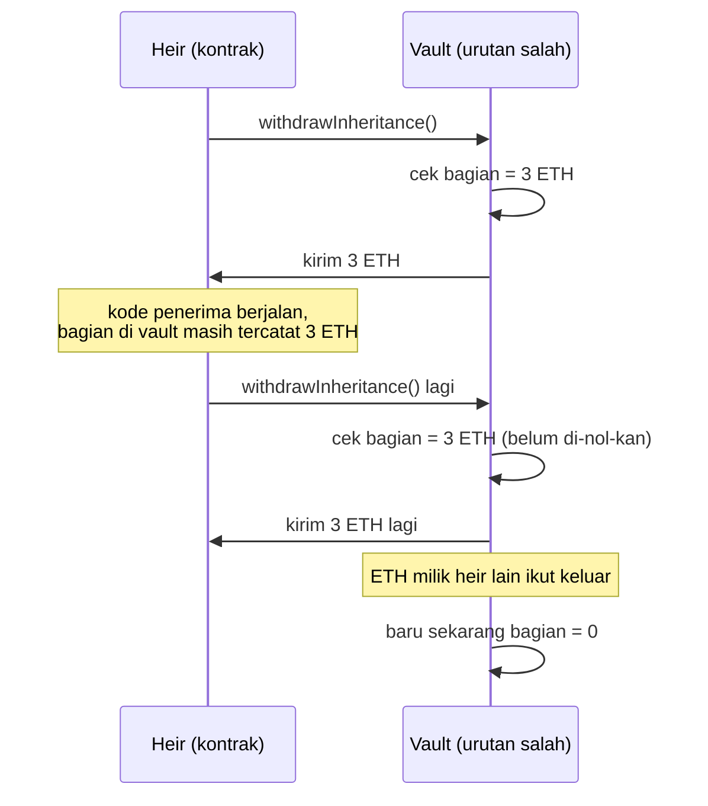
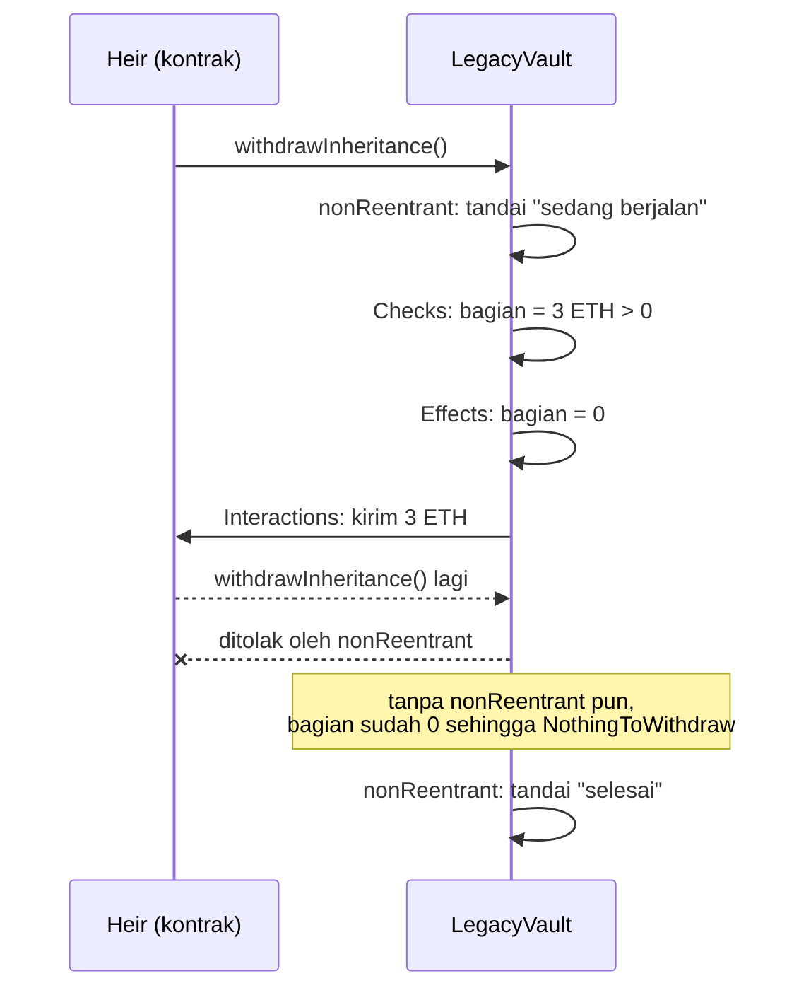
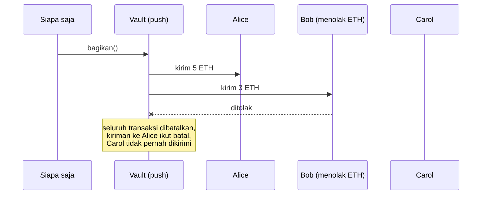
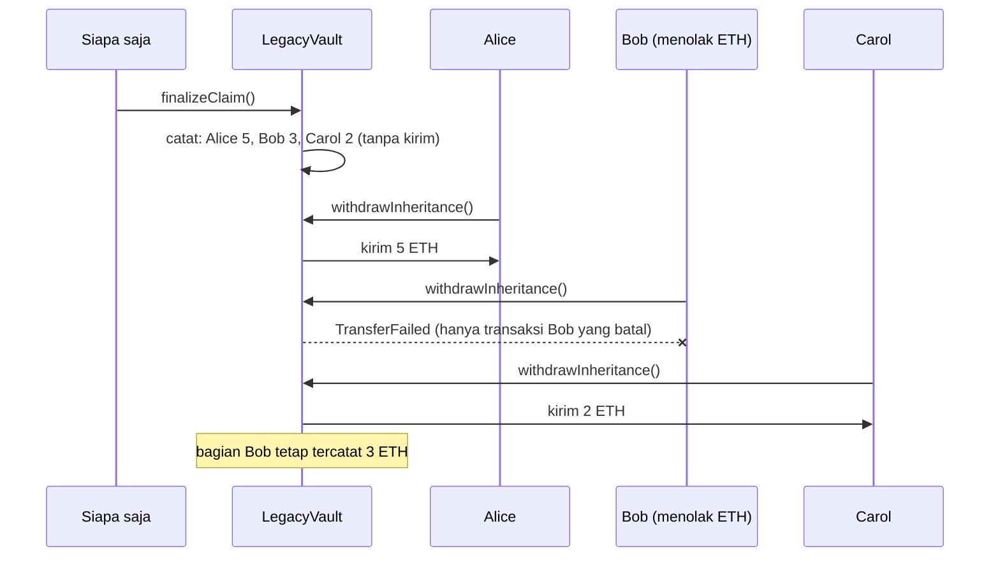

# Penjelasan Proyek LegacyVault

Dokumen ini ditulis untuk pemilik proyek yang baru mengenal Web3. Setiap tahap pengerjaan menambah satu bagian baru di sini.

---

## Tahap 0: Persiapan proyek

### 1. Apa yang dibuat di tahap ini

Belum ada smart contract yang ditulis. Tahap ini hanya menyiapkan alat kerja:

- **Foundry** dipasang di komputer (versi 1.9.0). Isinya `forge`, `anvil`, `cast`, dan `chisel`.
- Folder ini dijadikan proyek Foundry. Strukturnya:
  - `src/`: tempat kode smart contract (`.sol`) nanti.
  - `test/`: tempat kode pengujian.
  - `script/`: tempat skrip deploy.
  - `lib/`: pustaka dari pihak lain. Isinya `forge-std` (alat bantu test bawaan Foundry) dan `openzeppelin-contracts` versi 5.7.0.
  - `foundry.toml`: file pengaturan proyek.
- Versi compiler Solidity dikunci ke **0.8.28** di `foundry.toml`.
- Proyek dijadikan repositori Git, dan `.gitignore` disiapkan supaya file rahasia (`.env`) dan file hasil build tidak ikut tersimpan.
- File contoh `Counter` bawaan Foundry dihapus karena tidak dipakai.

### 2. Konsep yang dipakai

**Smart contract.** Program kecil yang disimpan dan dijalankan di blockchain. Begitu dipasang, kodenya tidak bisa diubah diam-diam, dan siapa pun bisa melihat apa yang dikerjakannya. Analoginya mesin penjual otomatis: aturannya sudah tertanam di mesin, tidak perlu penjaga toko.

**Solidity.** Bahasa pemrograman untuk menulis smart contract di Ethereum. Kode Solidity harus di-*compile* (diterjemahkan) dulu menjadi *bytecode* yang dimengerti blockchain.

**Foundry.** Satu paket alat untuk membuat, menguji, dan memasang smart contract. Analoginya kotak perkakas tukang: satu kotak berisi beberapa alat dengan fungsi berbeda.

- **forge**: alat utama. `forge build` meng-compile kode Solidity, `forge test` menjalankan pengujian. Test di Foundry juga ditulis dalam Solidity, jadi tidak perlu belajar bahasa kedua.
- **anvil**: blockchain Ethereum tiruan yang berjalan di komputer sendiri. Saat dinyalakan, anvil langsung menyediakan 10 akun yang masing-masing berisi 10.000 ETH palsu.
- **cast**: alat baris perintah untuk "mengobrol" dengan blockchain, misalnya mengecek saldo atau memanggil fungsi kontrak tanpa membuat UI.
- **chisel**: tempat mencoba potongan kode Solidity secara cepat. Jarang dipakai di proyek ini.

**OpenZeppelin Contracts.** Kumpulan kode smart contract yang sudah diaudit dan dipakai luas. Proyek ini hanya mengambil satu bagian, `ReentrancyGuard`, yaitu pengaman terhadap serangan *reentrancy*. Serangan itu akan dijelaskan di tahap berikutnya. Analoginya membeli kunci pintu bersertifikat daripada membuat kunci sendiri.

**Mengunci versi compiler.** Versi Solidity yang berbeda bisa menghasilkan bytecode yang sedikit berbeda, dan kadang ada perbaikan bug di antara versi. Dengan mengunci ke 0.8.28, siapa pun yang menjalankan `forge build` (dosen, teman, atau server) mendapat hasil yang sama.

**Kenapa menguji di blockchain lokal dulu?**

1. **Gratis.** Setiap transaksi di jaringan Ethereum asli membayar biaya (*gas*) dengan ETH sungguhan. Di anvil, ETH-nya palsu.
2. **Cepat.** Di jaringan asli, transaksi menunggu belasan detik untuk masuk blok. Di anvil, langsung.
3. **Bisa memutar waktu.** Kontrak ini bergantung pada waktu ("pemilik tidak aktif selama periode tertentu", misalnya 180 hari). Di jaringan asli kita harus benar-benar menunggu. Di Foundry, `vm.warp` bisa melompatkan waktu dalam sekejap.
4. **Kesalahan tidak permanen.** Kontrak yang sudah terpasang di jaringan asli tidak bisa diperbaiki. Jika ada bug yang membuat ETH terkunci, ETH itu hilang selamanya. Di lokal, cukup matikan anvil dan mulai lagi.

Analoginya simulator mengemudi: berlatih menabrak di simulator jauh lebih murah daripada di jalan raya.

### 3. Pertanyaan yang mungkin diajukan dosen

**T: Kenapa memakai Foundry, bukan Hardhat atau Remix?**
J: Remix berjalan di browser dan cocok untuk mencoba, tetapi kurang cocok untuk proyek dengan banyak test. Hardhat menulis test dalam JavaScript, sedangkan Foundry menulis test dalam Solidity, bahasa yang sama dengan kontraknya. Foundry juga menyediakan fuzz testing (menguji dengan ribuan input acak) secara bawaan, dan itu dipakai untuk memeriksa perhitungan pembagian warisan.

**T: Apa bedanya anvil dengan testnet seperti Sepolia?**
J: Anvil hanya berjalan di komputer sendiri dan hilang saat dimatikan. Sepolia adalah jaringan publik yang mirip Ethereum asli, tetapi ETH-nya tidak bernilai. Anvil dipakai untuk pengembangan dan pengujian sehari-hari karena cepat dan bisa dikendalikan penuh, termasuk waktunya.

**T: Kenapa hanya memakai `ReentrancyGuard` dari OpenZeppelin, tidak lebih?**
J: Supaya kode tetap sederhana dan bisa dipahami sendiri. Bagian lain, seperti aturan peran pemilik, ahli waris, dan guardian, ditulis langsung karena kebutuhannya spesifik dan lebih mudah dijelaskan. `ReentrancyGuard` diambil karena ini pengaman keamanan yang sudah teruji, dan membuatnya sendiri justru berisiko.

**T: Kenapa file `.env` tidak di-commit?**
J: File `.env` biasanya berisi private key. Siapa pun yang memegang private key bisa memindahkan seluruh isi akun tersebut. Jika file itu masuk Git dan diunggah ke GitHub, kunci itu bisa dibaca orang lain.

**T: Kenapa versi Solidity 0.8.x?**
J: Mulai versi 0.8.0, Solidity otomatis menolak operasi aritmetika yang meluap (*overflow*), misalnya angka yang melewati batas maksimum lalu berputar menjadi kecil. Di versi lama, ini sumber banyak bug dan pencurian dana. 0.8.28 dipilih karena stabil dan didukung OpenZeppelin 5.7.0 (yang membutuhkan minimal 0.8.20).

---

## Tahap 1: Smart contract LegacyVault

### 1. Apa yang dibuat di tahap ini

File `src/LegacyVault.sol`, yaitu smart contract brankas ETH yang bisa diwariskan, sesuai SPEC.md bagian 2 sampai 5. Isinya:

- **Tiga peran:** owner (pemilik), heir (ahli waris, maksimal 10), dan guardian (pihak tepercaya penyetuju klaim, maksimal 10).
- **Fungsi owner:** `deposit`, `withdraw`, `checkIn`, `updateHeirs`, `cancelClaim`.
- **Alur klaim warisan:** `startClaim`, lalu `approveClaim`, lalu `finalizeClaim`, lalu setiap heir memanggil `withdrawInheritance`.
- **`getStatus`:** mengembalikan ringkasan status dalam satu panggilan untuk UI nanti.
- **Validasi lengkap** saat deploy dan saat daftar ahli waris diganti: tidak boleh alamat kosong, tidak boleh duplikat, owner tidak boleh punya peran lain, guardian tidak boleh sekaligus heir, dan total porsi harus tepat 100%.

Hasil `forge build`: "Compiler run successful!" tanpa warning. Test lengkap untuk setiap fungsi dibuat di tahap berikutnya.

### 2. Konsep yang dipakai

**State machine (mesin status).** Vault selalu berada di salah satu dari tiga keadaan, dan setiap fungsi hanya boleh dipanggil di keadaan tertentu.

```
            startClaim                finalizeClaim
  Active  ------------->  Claiming  ---------------->  Distributed
    ^                        |
    |      cancelClaim       |
    +------------------------+
```

- **Active:** pemilik dianggap masih ada. Ia bebas menyetor, menarik, dan mengganti ahli waris.
- **Claiming:** ada klaim warisan yang sedang berjalan. Uang belum bisa ditarik siapa pun. Pemilik masih bisa membatalkan.
- **Distributed:** final, tidak bisa kembali. Bagian setiap ahli waris sudah dihitung dan tinggal diambil.

Analoginya lampu lalu lintas: dari hijau ke kuning ke merah, dengan urutan yang sudah ditentukan. Di kode, aturan ini dijaga oleh modifier `inState(...)`. Contohnya, `withdraw` memakai `inState(State.Active)`, sehingga owner tidak bisa menarik dana diam-diam saat klaim sedang berjalan.

**Check-in (tanda masih hidup).** Setiap kali owner melakukan sesuatu (setor, tarik, ganti ahli waris, atau sekadar `checkIn`), kontrak mencatat waktunya di `lastCheckIn`. Klaim baru boleh dimulai jika sudah lewat `inactivityPeriod` sejak check-in terakhir. Analoginya penjaga yang bertanya "masih ada orang di rumah?" secara berkala.

**Kenapa persetujuan terikat `claimId`?** Bayangkan urutan kejadian ini tanpa `claimId`:
1. Klaim dimulai. Guardian A menyetujui.
2. Pemilik ternyata masih hidup dan membatalkan klaim.
3. Setahun kemudian ada klaim baru. Persetujuan A dari klaim lama masih tercatat, padahal A belum tentu setuju dengan klaim yang baru.

Untuk mencegah ini, setiap klaim diberi nomor (`claimId`) yang naik setiap kali `startClaim` dipanggil. Persetujuan disimpan sebagai `hasApproved[nomorKlaim][guardian]`. Klaim baru punya nomor baru, jadi kolom persetujuannya otomatis kosong. Persetujuan lama tidak perlu dihapus satu per satu. Data itu tetap ada, tetapi tidak pernah dibaca lagi. Analoginya formulir bernomor: tanda tangan di formulir nomor 1 tidak berlaku untuk formulir nomor 2.

**Basis point.** Porsi warisan ditulis dalam basis point (bps): 10000 bps = 100%, jadi 1 bps = 0,01%. Solidity tidak punya bilangan desimal, sehingga porsi seperti 33,33% ditulis 3333. Pembagian bilangan bulat selalu membulatkan ke bawah, dan sisa beberapa wei hasil pembulatan diberikan ke heir terakhir. Hasilnya, tidak ada ETH yang tertinggal terkunci di kontrak.

**Pull payment (ambil sendiri).** `finalizeClaim` tidak mengirim ETH ke siapa pun. Fungsi ini hanya mencatat bagian setiap heir. Setiap heir lalu mengambil sendiri lewat `withdrawInheritance`. Jika kontrak mengirim ke semua heir sekaligus dalam satu loop, satu heir yang alamatnya menolak ETH akan membuat seluruh pembagian gagal, dan heir lain ikut tidak dapat apa-apa. Analoginya bank yang menyiapkan amplop atas nama masing-masing, lalu setiap orang datang mengambil amplopnya sendiri.

**Checks-Effects-Interactions dan reentrancy.** Urutan di `withdrawInheritance`:
1. **Checks:** periksa apakah bagiannya lebih dari 0.
2. **Effects:** ubah catatan bagiannya menjadi 0.
3. **Interactions:** baru kirim ETH.

Kenapa catatan di-nol-kan sebelum mengirim? Penerima ETH bisa berupa smart contract yang, begitu menerima uang, langsung memanggil `withdrawInheritance` lagi (*reentrancy*). Jika catatannya belum di-nol-kan, ia bisa menarik berkali-kali. Analoginya kasir yang mencoret nama di daftar sebelum menyerahkan uang, bukan sesudahnya. Sebagai lapisan kedua, fungsi ini juga memakai `nonReentrant` dari OpenZeppelin, yang menolak panggilan ulang selama fungsi masih berjalan.

**Custom error.** Saat transaksi gagal, kontrak mengembalikan error bernama, misalnya `OwnerStillActive(activeUntil)`, bukan kalimat panjang. Biayanya lebih murah, dan UI bisa membaca datanya. Contohnya UI bisa menampilkan "klaim baru bisa dimulai tanggal sekian".

**Linter.** Forge versi 1.x punya pemeriksa gaya kode (linter) yang memberi peringatan untuk pola yang sering berbahaya. Ada empat jenis peringatan yang muncul, dan semuanya sudah ditangani:
- **Kirim ETH ke alamat yang ditentukan pengguna:** kode diatur ulang supaya terlihat jelas bahwa ETH hanya dikirim ke owner, atau ke heir yang memanggil sendiri.
- **`revert` di dalam loop:** disengaja. Satu alamat yang tidak valid memang harus membatalkan seluruh daftar.
- **Pemakaian `block.timestamp`:** disengaja. Validator hanya bisa menggeser waktu blok beberapa detik, sedangkan periode di kontrak ini minimal 1 hari.
- **Perubahan `isHeir` tanpa event:** salah deteksi. Event `HeirsUpdated` sebenarnya dipancarkan di akhir fungsi yang sama.

Untuk tiga yang terakhir, peringatan dimatikan hanya di baris atau fungsi itu dengan komentar `// forge-lint: disable-...`, dan alasannya ditulis di sebelahnya.

### 3. Pertanyaan yang mungkin diajukan dosen

**T: Bagaimana kontrak tahu pemiliknya sudah meninggal?**
J: Tidak tahu. Kontrak hanya tahu pemilik tidak melakukan apa pun selama `inactivityPeriod`. Karena itu ada tiga lapisan pengaman: persetujuan guardian, masa tunggu (timelock), dan hak pemilik untuk membatalkan klaim selama masa tunggu.

**T: Apa yang terjadi kalau pemilik ternyata masih hidup ketika klaim berjalan?**
J: Pemilik memanggil `cancelClaim`. Vault kembali ke Active, waktu check-in diperbarui, dan semua persetujuan klaim itu tidak berlaku lagi karena klaim berikutnya memakai `claimId` baru.

**T: Kenapa guardian tidak boleh sekaligus ahli waris?**
J: Konflik kepentingan. Orang yang diuntungkan oleh klaim tidak boleh menjadi orang yang menyetujui klaim tersebut.

**T: Kenapa `finalizeClaim` boleh dipanggil siapa saja?**
J: Karena semua syaratnya diperiksa di dalam fungsi: persetujuan cukup dan masa tunggu sudah lewat. Siapa pun yang memanggil, hasilnya sama. Ini mencegah dana tertahan hanya karena satu orang tertentu tidak mau atau tidak bisa memanggilnya.

**T: Kenapa memakai `call` untuk mengirim ETH, bukan `transfer`?**
J: `transfer` hanya memberi penerima 2300 gas. Penerima berupa smart contract wallet (misalnya multisig) bisa butuh lebih dari itu, sehingga `transfer` gagal. `call` meneruskan gas yang cukup. Karena `call` tidak otomatis membatalkan transaksi saat gagal, hasilnya dicek manual dengan `if (!success) revert TransferFailed();`. Risiko reentrancy dari `call` ditutup oleh Checks-Effects-Interactions dan `nonReentrant`.

**T: Kenapa jumlah ahli waris dan guardian dibatasi 10?**
J: `finalizeClaim` dan `updateHeirs` memakai loop sepanjang daftar. Setiap putaran memakan gas, dan satu blok punya batas gas. Jika daftarnya tidak dibatasi, loop bisa terlalu mahal dan fungsi tidak bisa dipanggil sama sekali, sehingga dana terkunci.

**T: Kenapa sisa pembulatan diberikan ke heir terakhir?**
J: Contohnya, 1 ETH ditambah 1 wei dibagi 3333/3333/3334 bps tidak habis dibagi. Tanpa aturan ini, sisa beberapa wei akan tertinggal di kontrak selamanya. Memberikannya ke heir terakhir menjamin jumlah semua bagian tepat sama dengan saldo yang dibagi.

---

## Tahap 2: Pengujian

### 1. Apa yang dibuat di tahap ini

- `test/LegacyVault.t.sol` berisi **92 test**, dan semuanya lolos: `92 tests passed, 0 failed, 0 skipped`. Kelompok test-nya:
  - **Constructor (23 test):** konfigurasi valid, batas tepat 10 heir/guardian dan periode tepat 1 hari, plus setiap aturan validasi yang dilanggar. Contohnya total porsi 9999 dan 10001, alamat nol, duplikat, owner sebagai heir/guardian, guardian sebagai heir, threshold 0 atau melebihi jumlah guardian, 11 heir, 11 guardian, periode 1 hari kurang 1 detik.
  - **Fase Active (27 test):** `deposit`, `receive`, `withdraw`, `checkIn`, dan `updateHeirs`. Setiap fungsi dicoba oleh peran yang benar dan yang salah, serta di state yang salah. Ada juga satu fuzz test yang mencoba 1000 alamat acak bukan-owner terhadap semua fungsi owner.
  - **Klaim (21 test):** klaim terlalu cepat, guardian menyetujui dua kali, bukan-guardian menyetujui, finalize sebelum threshold, dan finalize sebelum timelock (tepat 1 detik sebelum `unlockTime`).
  - **Pembatalan (7 test):** termasuk skenario approve, lalu cancel, lalu klaim baru, dan persetujuan lama tidak terhitung.
  - **Pencairan (11 test):** bagian setiap heir tepat, sisa pembulatan jatuh ke heir terakhir, tidak bisa menarik dua kali, bukan-heir ditolak, setoran setelah Distributed ditolak, dan heir yang menolak ETH tidak mengganggu heir lain.
  - **`getStatus`:** satu test yang memeriksa isinya di ketiga state.
  - **Fuzz pembagian warisan:** 1000 kombinasi acak saldo (0 sampai 1 miliar ETH), jumlah heir (1 sampai 10), dan porsi.
  - **End-to-end:** dari setoran sampai semua heir menarik.
- Output asli `forge test -vv` disimpan di `docs/test-output.txt`, dan output `forge test --gas-report` di `docs/gas-report.txt`.
- `foundry.toml` mendapat pengaturan `[fuzz] runs = 1000`. Bawaan Foundry hanya 256 run.

**Apakah ada bug yang ditemukan?** Tidak ada bug di kontrak. Semua test lolos sejak run pertama. Ada dua perbaikan, keduanya di file test, bukan di kontrak:
1. Satu baris test tidak bisa di-compile. Penyebabnya, `((1 ether + 7) * 3333) / 10000` dihitung compiler sebagai pecahan, bukan bilangan bulat. Perbaikannya, angkanya disimpan dulu di variabel.
2. Linter memperingatkan pemakaian `block.timestamp` setelah `vm.warp`. Pada mode compiler tertentu, nilai itu bisa "basi" (masih nilai lama), sehingga test membaca waktu yang salah. Semua pemakaiannya di test diganti dengan `vm.getBlockTimestamp()`, cara yang dianjurkan Foundry.

**Bukti bahwa test-nya tidak asal hijau.** Test yang langsung lolos bisa saja test yang lemah. Untuk mengujinya, kontrak sengaja dirusak di tiga tempat, satu per satu. Setiap kali, test dijalankan ulang, lalu kontraknya dikembalikan:

| Kerusakan yang disengaja | Test yang gagal |
|---|---|
| Sisa pembulatan tidak diberikan ke heir terakhir | Fuzz test pembagian (menemukan selisih 1 wei) dan test pembulatan |
| Hitungan persetujuan tidak di-reset saat klaim baru atau cancel | Dua test pembatalan |
| Bagian heir tidak di-nol-kan sebelum ETH dikirim | Test tarik dua kali dan test bagian setiap heir |

Ketiga kerusakan itu tertangkap. Artinya, test benar-benar menjaga aturan penting di SPEC.

**Sebagian angka gas dari `docs/gas-report.txt`.** Angka ini diukur di lingkungan test, jadi biaya di jaringan asli bisa sedikit berbeda.

| Fungsi | Median gas | Maksimum gas |
|---|---|---|
| Deploy kontrak | 2.961.888 (satu kali) | |
| `deposit` | 25.136 | 31.354 |
| `startClaim` | 78.865 | 78.865 |
| `approveClaim` | 75.136 | 82.094 |
| `finalizeClaim` | 173.816 | 333.016 (10 heir) |
| `withdrawInheritance` | 45.118 | 45.118 |

Angka "Min" di laporan biasanya berasal dari panggilan yang gagal (revert di awal), jadi tidak mewakili biaya normal.

### 2. Konsep yang dipakai

**Unit test.** Program kecil yang memanggil kontrak lalu memeriksa hasilnya. Contohnya: "setelah alice menarik, saldo alice harus 5 ETH". Jika ada yang tidak sesuai, test gagal dan menunjukkan baris mana yang salah. Analoginya daftar periksa inspeksi kendaraan: setiap butir diperiksa satu per satu, dan satu butir yang gagal membuat kendaraan tidak lulus.

**Jalur berhasil dan jalur gagal.** Setiap fungsi diuji dua arah: bahwa ia bekerja untuk orang yang berhak, dan bahwa ia **menolak** orang yang tidak berhak dengan error yang tepat. Untuk smart contract, jalur gagal sama pentingnya, karena penyerang selalu mencoba memanggil fungsi yang bukan haknya.

**Alat bantu Foundry (cheatcode).** Test di Foundry bisa memanipulasi blockchain tiruan:
- `vm.prank(alamat)`: panggilan berikutnya dianggap datang dari alamat itu. Dengan ini satu test bisa memerankan owner, heir, guardian, atau orang asing.
- `vm.warp(waktu)`: melompatkan jam blockchain. Masa tidak aktif 180 hari bisa diuji dalam sekejap.
- `vm.expectRevert(error)`: menyatakan bahwa panggilan berikutnya **harus** gagal dengan error tertentu. Jika ternyata berhasil, atau gagal dengan error lain, test-nya yang gagal.
- `vm.expectEmit`: memeriksa bahwa event yang benar dipancarkan.
- `vm.deal(alamat, jumlah)`: mengisi saldo ETH palsu.

**Uji batas (boundary).** Banyak bug muncul tepat di batas, misalnya `<` yang seharusnya `<=`. Karena itu test memeriksa nilai di sekitar batas: klaim 1 detik sebelum masa tidak aktif habis harus gagal, klaim tepat saat batas harus berhasil, finalize 1 detik sebelum `unlockTime` harus gagal, dan 10 heir diterima sedangkan 11 ditolak.

**Fuzz test.** Biasanya test memakai angka yang kita pilih sendiri. Fuzz test membiarkan Foundry memilih angka acak ribuan kali. Di sini Foundry mencoba 1000 kombinasi saldo, jumlah heir, dan porsi, lalu setiap kali memeriksa dua hal:
1. Total yang ditarik semua heir tidak pernah melebihi snapshot (invariant 1).
2. Setelah semua heir menarik, totalnya tepat sama dengan snapshot dan saldo kontrak 0 (invariant 2).

Analoginya menguji timbangan dengan seribu barang berbeda, bukan hanya dengan satu batu yang beratnya sudah kita tahu.

**Kontrak penolak ETH.** Test memakai dua kontrak kecil, `RejectingHeir` dan `RejectingOwner`, yang sengaja tidak bisa menerima ETH. Keduanya membuktikan dua hal:
- Kontrak memeriksa hasil `call` dan mengembalikan error `TransferFailed`, bukan diam-diam menganggap pengiriman berhasil.
- Berkat pull payment, satu heir yang bermasalah tidak menghalangi heir lain menarik bagiannya.

**Laporan gas.** Setiap operasi di Ethereum memakan *gas*, satuan kerja komputasi yang dibayar dengan ETH. Laporan gas menunjukkan biaya setiap fungsi. Contohnya, `finalizeClaim` paling mahal karena harus menghitung bagian untuk setiap heir dalam loop. Biayanya naik seiring jumlah heir, dan itulah alasan jumlah heir dibatasi 10.

### 3. Pertanyaan yang mungkin diajukan dosen

**T: Bagaimana Anda tahu test-nya cukup?**
J: Dengan tiga cara. Pertama, setiap fungsi publik punya test jalur berhasil dan jalur gagal. Kedua, nilai di sekitar batas diuji. Ketiga, kontrak sengaja dirusak di tiga tempat penting, dan test langsung gagal setiap kali. Test yang tetap hijau ketika kodenya rusak tidak ada gunanya.

**T: Apa bedanya fuzz test dengan unit test biasa?**
J: Unit test memakai contoh yang kita pilih, misalnya 10 ETH dibagi 50/30/20. Fuzz test memakai ribuan input acak, sehingga bisa menemukan kasus yang tidak terpikirkan, seperti saldo yang menghasilkan sisa pembulatan 1 wei. Ini terbukti saat percobaan merusak kontrak: fuzz test-lah yang menemukan selisih 1 wei.

**T: Kenapa test memeriksa jenis error, bukan sekadar "transaksi gagal"?**
J: Transaksi bisa gagal karena alasan yang salah. Contohnya, test "bukan-guardian tidak boleh menyetujui" bisa saja lolos karena state-nya keliru, bukan karena pemeriksaan perannya bekerja. Dengan mencocokkan error yang tepat (`NotGuardian`), kita tahu pengaman yang dimaksud benar-benar bekerja.

**T: Kenapa ada test "heir tetap boleh berada di daftar baru saat `updateHeirs`"?**
J: Kontrak mendeteksi duplikat dengan tanda `isHeir`. Jika tanda lama lupa dihapus sebelum daftar baru dipasang, heir yang dipertahankan akan dianggap duplikat, dan owner tidak bisa sekadar mengubah porsi. Test ini menjaga agar urutan "hapus tanda lama, lalu pasang daftar baru" tidak rusak di kemudian hari.

**T: Apakah angka gas di laporan sama dengan biaya di Ethereum asli?**
J: Mendekati, tetapi tidak persis. Laporan gas mengukur jumlah unit gas. Biaya dalam rupiah tergantung harga gas saat itu dan harga ETH. Laporan ini berguna untuk membandingkan fungsi mana yang mahal, bukan untuk menghitung tagihan pasti.

---

## Tahap 3: Bukti mitigasi keamanan

### 1. Apa yang dibuat di tahap ini

- **`test/security/LegacyVault.security.t.sol`:** 34 test keamanan, dikelompokkan per baris tabel ancaman di SPEC.md bagian 7. Setiap kelompok diawali komentar yang menyebut ancaman dan mitigasinya. 33 test dipindahkan apa adanya dari file test tahap 2 (dengan skrip, bukan diketik ulang), dan 1 test baru ditambahkan: `updateHeirs` menolak 11 heir.
- **`test/utils/LegacyVaultFixture.sol`:** konfigurasi dan helper bersama, supaya file test utama dan file test keamanan memakai `setUp` yang sama.
- **`test/LegacyVault.t.sol`:** sekarang berisi 59 test fungsional.

  Total test menjadi 93 (59 + 34), semuanya lolos. Output asli test keamanan ada di `docs/security-output.txt`.
- **`docs/MUTATION.md`:** hasil uji perusakan untuk 22 mutasi, satu atau lebih per mitigasi. Output asli setiap mutasi ada di `docs/mutation/M01.txt` sampai `M22.txt`. Semua mutasi dijalankan di branch sementara yang lalu dihapus, dan kode yang dirusak tidak pernah di-commit.

**Hasil uji perusakan:**
- 19 dari 22 mutasi tertangkap oleh test keamanan.
- 1 mutasi (M16) hanya tertangkap oleh test fungsional, dan memang tidak berdampak pada keamanan.
- **2 mutasi tidak tertangkap test mana pun:** membalik urutan Checks-Effects-Interactions (M02) dan menghapus `nonReentrant` (M03).

Penyebab M02 dan M03 lolos dijelaskan di bawah. Ini batasan yang perlu Anda ketahui dan bisa Anda sampaikan ke dosen.

### 2. Konsep yang dipakai

#### Reentrancy (masuk ulang)

Saat kontrak mengirim ETH ke sebuah alamat, dan alamat itu ternyata smart contract, kontrak penerima boleh menjalankan kodenya sendiri **di tengah-tengah** proses pengiriman. Kode itu bisa memanggil balik kontrak pengirim sebelum fungsi pertama selesai. Itulah *reentrancy*.

Bahayanya muncul jika kontrak pengirim **mengirim dulu, baru mencatat**. Diagram berikut menggambarkan versi yang salah (urutan terbalik). Versi ini **tidak** dipakai di LegacyVault.



Urutan di LegacyVault, yang memakai Checks-Effects-Interactions dan `nonReentrant`:



**Analogi.** Kasir bank memegang daftar nama dan jumlah uang yang boleh diambil.
- Kasir yang ceroboh menyerahkan uang dulu, baru mencoret nama. Selama kasir masih sibuk menghitung uang di meja, orang yang sama bisa menyerobot antrean dan meminta lagi, dan namanya masih belum dicoret.
- Kasir yang benar mencoret nama **sebelum** menyerahkan uang (Checks-Effects-Interactions), dan menutup loket selama satu transaksi berjalan (`nonReentrant`).

**Kenapa uji perusakan tidak menangkap M02 dan M03?** Di test, penerima ETH adalah alamat biasa yang tidak menjalankan kode saat menerima ETH. Dalam kondisi itu, urutan "kirim dulu" atau "catat dulu" memberi hasil yang sama, karena tidak ada yang menyerobot. Test membuktikan bahwa bagian heir di-nol-kan dan tidak bisa ditarik dua kali secara berurutan, tetapi tidak bisa membuktikan perlindungan terhadap panggilan ulang di tengah pengiriman. Itu sebabnya ada **dua lapisan**:
- Jika urutannya terbalik tetapi `nonReentrant` ada, panggilan ulang tetap ditolak.
- Jika `nonReentrant` hilang tetapi urutannya benar, panggilan ulang menemukan bagian yang sudah 0.

Kontrak baru rentan jika keduanya rusak sekaligus. Untuk dua baris ini, pengamannya adalah tinjauan kode dan komentar di atas fungsi `withdrawInheritance`.

#### DoS (Denial of Service) karena push payment

*Push payment* berarti kontrak mengirim ETH ke semua penerima dalam satu loop. Jika satu pengiriman gagal dan kontrak membatalkan transaksi, **seluruh** loop ikut batal. Satu heir yang alamatnya menolak ETH, baik sengaja maupun karena wallet-nya bermasalah, membuat tidak ada seorang pun yang menerima warisan. Pembagian itu tidak akan pernah berhasil, berapa kali pun dicoba.

Diagram berikut menggambarkan desain push. Desain ini **tidak** dipakai di LegacyVault.



Desain LegacyVault, dengan pull payment:



**Analogi.**
- Push payment seperti kurir yang membawa tiga paket dalam satu perjalanan, dengan aturan "kalau satu paket ditolak, semua paket dibawa pulang". Satu penerima yang tidak mau membuka pintu membuat dua penerima lain tidak dapat paket.
- Pull payment seperti loket pengambilan: paket disiapkan atas nama masing-masing, dan setiap orang datang mengambil sendiri. Satu orang yang tidak datang tidak mengganggu orang lain.

Test `test_RevertWhen_HeirRejectsEth_OtherHeirsUnaffected` membuktikan hal ini. Mutasi M04 juga menunjukkan kenapa hasil `call` wajib dicek: tanpa pemeriksaan itu, bagian Bob akan di-nol-kan padahal ETH-nya tidak pernah sampai.

#### Uji perusakan (mutation check)

Caranya, kontrak sengaja dirusak satu baris, lalu test dijalankan. Jika test gagal, test itu terbukti menjaga baris tersebut. Jika test tetap hijau, ada celah, dan celah itu harus dicatat dengan jujur, seperti M02 dan M03. Analoginya menguji alarm rumah dengan sengaja membuka jendela: alarm yang tidak berbunyi berarti ada jendela yang tidak dijaga.

### 3. Pertanyaan yang mungkin diajukan dosen

**T: Kenapa tidak membuat kontrak penyerang untuk membuktikan perlindungan reentrancy?**
J: Proyek ini sengaja tidak memuat kode penyerang. Sebagai gantinya, perlindungan dibuktikan dengan tiga cara. Pertama, test menunjukkan bagian heir di-nol-kan dan tidak bisa ditarik dua kali. Kedua, kontrak memakai dua lapisan yang saling menutupi (CEI dan `nonReentrant`). Ketiga, uji perusakan dilaporkan apa adanya: dua mutasi itu tidak tertangkap, beserta alasannya.

**T: Jika sudah ada `nonReentrant`, kenapa masih perlu Checks-Effects-Interactions?**
J: Pertahanan berlapis. `nonReentrant` hanya melindungi fungsi yang memakainya. CEI adalah kebiasaan menulis kode yang tetap aman walaupun suatu hari modifier itu terhapus atau ada fungsi baru yang lupa diberi modifier. Uji perusakan menunjukkan bahwa menghapus salah satu lapisan saja tidak langsung membuat kontrak rentan.

**T: Kenapa M16 tidak dianggap celah keamanan?**
J: Hitungan persetujuan juga di-reset di `startClaim`, dan klaim baru adalah satu-satunya jalan menuju pencairan. Jadi angka lama hanya terlihat di `getStatus()` selama vault kembali Active, dan tidak bisa dipakai untuk mencairkan dana. Test fungsional tetap menangkapnya supaya tampilan UI tidak menyesatkan.

**T: Apa yang terjadi pada bagian heir yang alamatnya menolak ETH?**
J: Bagiannya tetap tercatat di `inheritanceOf` dan tidak hilang. ETH-nya tertahan di kontrak sampai alamat itu bisa menerima ETH. Jika alamat itu tidak akan pernah bisa menerima ETH, bagian itu terkunci. Ini risiko yang ditanggung heir tersebut sendiri, bukan heir lain.

**T: Bagaimana jika pemilik lupa check-in dan klaim sudah disetujui guardian?**
J: Pemilik masih punya waktu sepanjang timelock (7 hari dalam konfigurasi test) untuk memanggil `cancelClaim`. Test `test_CancelClaim_DuringTimelockBlocksFinalize` membuktikan bahwa setelah pembatalan, klaim tidak bisa difinalisasi, dan klaim baru juga tidak bisa langsung dimulai karena pembatalan dihitung sebagai check-in.
