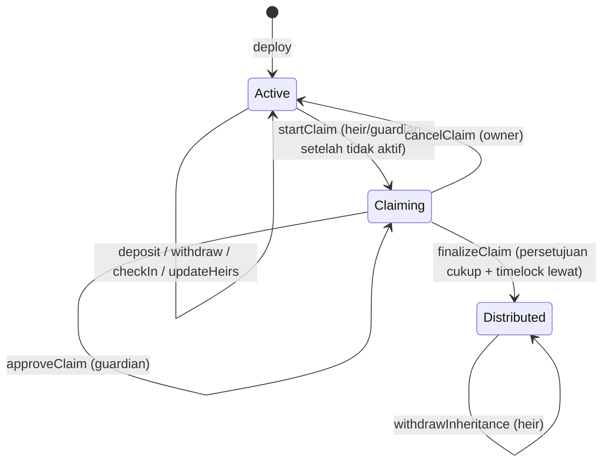

# Spesifikasi LegacyVault

Dokumen ini adalah sumber kebenaran desain. Jika kode dan dokumen ini berbeda, salah satunya harus diperbaiki secara sadar (bukan dibiarkan).

## 1. Masalah

Aset kripto hanya bisa dipindahkan oleh pemegang private key. Jika pemilik meninggal dunia, keluarga umumnya tidak dapat mengakses aset tersebut, dan tidak ada pihak pusat yang bisa "membukakan" akses.

LegacyVault adalah brankas (vault) ETH yang dapat diwariskan: selama pemilik aktif, hanya pemilik yang menguasai dana. Jika pemilik tidak aktif dalam jangka waktu tertentu, ahli waris dapat mengajukan klaim yang harus disetujui oleh guardian (pihak tepercaya) dan melewati masa tunggu (timelock) sebelum dana dibagikan.

### Batasan cakupan (dinyatakan eksplisit)
- Hanya ETH yang disetor ke vault yang dilindungi. Aset di wallet pribadi atau exchange terpusat (CEX) tidak tercakup.
- Kontrak tidak dapat mengetahui apakah pemilik benar-benar meninggal; kontrak hanya mengetahui bahwa pemilik **tidak aktif**. Guardian dan timelock adalah lapisan untuk mengurangi klaim keliru.
- Kontrak tidak menggantikan hukum waris. Kontrak mengatur pemindahan teknis, bukan hak hukum.
- Kasus "pemilik kehilangan private key" tidak dipulihkan ke pemilik; kasus itu akan berakhir sebagai pewarisan.

## 2. Peran

| Peran | Siapa | Wewenang |
|---|---|---|
| Owner | Alamat yang men-deploy kontrak | Deposit, tarik dana, check-in, ubah ahli waris, batalkan klaim |
| Heir (ahli waris) | 1–10 alamat, masing-masing punya porsi | Memulai klaim, menarik bagian warisan setelah final |
| Guardian | 1–10 alamat | Memulai klaim, menyetujui klaim |
| Siapa saja | Alamat mana pun | Memanggil `finalizeClaim` jika semua syarat terpenuhi, membaca status |

Aturan validasi peran (dicek di constructor dan `updateHeirs`):
- Tidak boleh ada alamat nol, tidak boleh duplikat.
- Owner tidak boleh menjadi heir atau guardian.
- Guardian tidak boleh sekaligus heir (mencegah konflik kepentingan: orang yang diuntungkan tidak boleh menjadi penyetuju).
- Total porsi heir harus tepat 10000 basis point (10000 bps = 100%). Setiap porsi > 0.
- `threshold` (jumlah persetujuan minimal) harus 1 ≤ threshold ≤ jumlah guardian.
- Maksimal 10 heir dan 10 guardian (membatasi panjang loop agar tidak terjadi gas DoS).
- `inactivityPeriod` dan `timelockPeriod` masing-masing minimal 1 hari dan maksimal 3650 hari (10 tahun). Batas atas mencegah penjumlahan waktu meluap (overflow), yang akan membuat `getStatus`, `startClaim`, atau `approveClaim` selalu gagal dan dana terkunci (temuan L-1 review tahap 7).

## 3. State machine

| State | Arti |
|---|---|
| `Active` | Pemilik dianggap aktif. Pemilik menguasai penuh dana. |
| `Claiming` | Klaim warisan sedang berjalan. Menunggu persetujuan guardian dan/atau timelock. Pemilik masih bisa membatalkan. |
| `Distributed` | Final. Bagian setiap heir sudah dihitung; heir menarik sendiri. Tidak bisa kembali. |

## 4. Fungsi

| Fungsi | Pemanggil | State yang diizinkan | Efek |
|---|---|---|---|
| `constructor(heirs, sharesBps, guardians, threshold, inactivityPeriod, timelockPeriod)` payable | deployer | - | Set konfigurasi, `lastCheckIn = now`, state `Active` |
| `receive()` / `deposit()` payable | siapa saja | `Active` | Tambah saldo. Jika pengirim owner, juga check-in |
| `withdraw(amount)` | owner | `Active` | Kirim ETH ke owner, check-in |
| `checkIn()` | owner | `Active` | `lastCheckIn = now` |
| `updateHeirs(heirs, sharesBps)` | owner | `Active` | Ganti daftar heir (validasi sama dengan constructor), check-in |
| `startClaim()` | heir atau guardian | `Active` | Syarat `now >= lastCheckIn + inactivityPeriod`. State → `Claiming`, `claimId++`, reset jumlah persetujuan |
| `approveClaim()` | guardian | `Claiming` | Satu guardian satu suara per `claimId`. Saat jumlah persetujuan mencapai `threshold`, set `unlockTime = now + timelockPeriod` |
| `cancelClaim()` | owner | `Claiming` | State → `Active`, `lastCheckIn = now`, persetujuan lama tidak berlaku lagi (karena terikat `claimId`) |
| `finalizeClaim()` | siapa saja | `Claiming` | Syarat persetujuan ≥ threshold dan `now >= unlockTime`. Hitung bagian setiap heir dari saldo saat itu. State → `Distributed` |
| `withdrawInheritance()` | heir | `Distributed` | Heir menarik bagiannya sendiri (pull payment) |
| `getStatus()` view | siapa saja | semua | Mengembalikan ringkasan status untuk UI |

### Perhitungan bagian warisan
- `snapshot = address(this).balance` saat `finalizeClaim`.
- Bagian heir ke-i = `snapshot * sharesBps[i] / 10000`.
- Sisa pembulatan (selisih `snapshot` dengan total bagian) diberikan ke heir terakhir, sehingga tidak ada wei yang terkunci.

## 5. Event

`Deposited(from, amount)`, `Withdrawn(to, amount)`, `CheckedIn(timestamp)`, `HeirsUpdated()`, `ClaimStarted(claimId, initiator)`, `ClaimApproved(claimId, guardian, approvals)`, `ClaimUnlockScheduled(claimId, unlockTime)`, `ClaimCancelled(claimId)`, `ClaimFinalized(claimId, snapshot)`, `InheritanceWithdrawn(heir, amount)`.

## 6. Invariant (harus selalu benar)

1. Total yang ditarik semua heir ≤ `snapshot`.
2. Setelah semua heir menarik, total yang ditarik = `snapshot` tepat (tidak ada wei tersisa dari snapshot).
3. Seorang heir tidak dapat menarik lebih dari bagiannya, dan tidak dapat menarik dua kali.
4. Pada state `Active`, hanya owner yang dapat mengeluarkan ETH dari kontrak.
5. Dana warisan tidak dapat cair tanpa: (a) masa tidak aktif terlewati, (b) persetujuan ≥ threshold pada klaim yang sama, (c) timelock terlewati.
6. Persetujuan dari klaim yang sudah dibatalkan tidak terbawa ke klaim berikutnya.

## 7. Model ancaman dan mitigasi

| Ancaman | Mitigasi | Bukti (test) |
|---|---|---|
| Reentrancy saat penarikan | Checks-Effects-Interactions + `ReentrancyGuard` | Test kontrak penyerang terhadap versi rentan vs versi aman |
| Satu heir memblokir pembagian (DoS) | Pull payment, bukan loop pengiriman | Test heir yang selalu menolak ETH terhadap versi push vs pull |
| Akses tanpa izin | Modifier peran per fungsi, visibilitas eksplisit | Test setiap fungsi dipanggil oleh peran yang salah |
| Klaim keliru saat pemilik masih hidup | Masa tidak aktif + persetujuan guardian + timelock + `cancelClaim` | Test pembatalan di tengah timelock |
| Persetujuan ganda / persetujuan lama dipakai ulang | Mapping persetujuan per `claimId` | Test approve dua kali; test approve → cancel → klaim baru |
| Manipulasi `block.timestamp` | Periode dalam hitungan hari; pergeseran beberapa detik tidak berarti | Dibahas di analisis keamanan |
| Pembulatan porsi | Basis point dengan total tepat 10000; sisa ke heir terakhir | Fuzz test invariant 1 dan 2 |
| Gas DoS karena daftar terlalu panjang | Batas 10 heir / 10 guardian | Test constructor menolak 11 heir |
| ETH dikirim setelah `Distributed` | `receive` ditolak di luar `Active` | Test deposit di state lain |

### Risiko yang diterima (tidak dimitigasi penuh, dibahas di dokumentasi)
- Guardian berkolusi dengan heir: dapat mencairkan dana jika pemilik tidak membatalkan selama timelock.
- Guardian tidak responsif / kehilangan kunci: klaim bisa tertahan; skema m-of-n hanya mengurangi risiko ini.
- Pemilik lupa check-in: klaim dapat dimulai, tetapi pemilik masih bisa membatalkan selama timelock.
- ETH yang dipaksa masuk tanpa melalui `receive` (misalnya lewat `selfdestruct`) setelah `Distributed` akan terkunci.
- Data heir, guardian, dan porsi terlihat publik di blockchain.
- Owner tidak dapat mengganti guardian (disederhanakan untuk tugas ini).
- Heir yang alamatnya tidak bisa menerima ETH (misalnya kontrak tanpa `receive`) tidak dapat menarik bagiannya; bagian itu terkunci selamanya. Heir lain tidak terdampak (temuan L-2 review tahap 7).
- Heir yang kehilangan private key tidak dapat menarik bagiannya; bagian itu terkunci selamanya.
