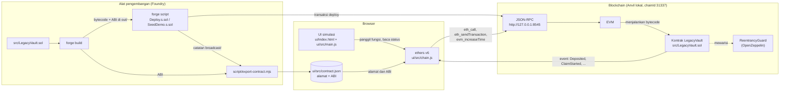
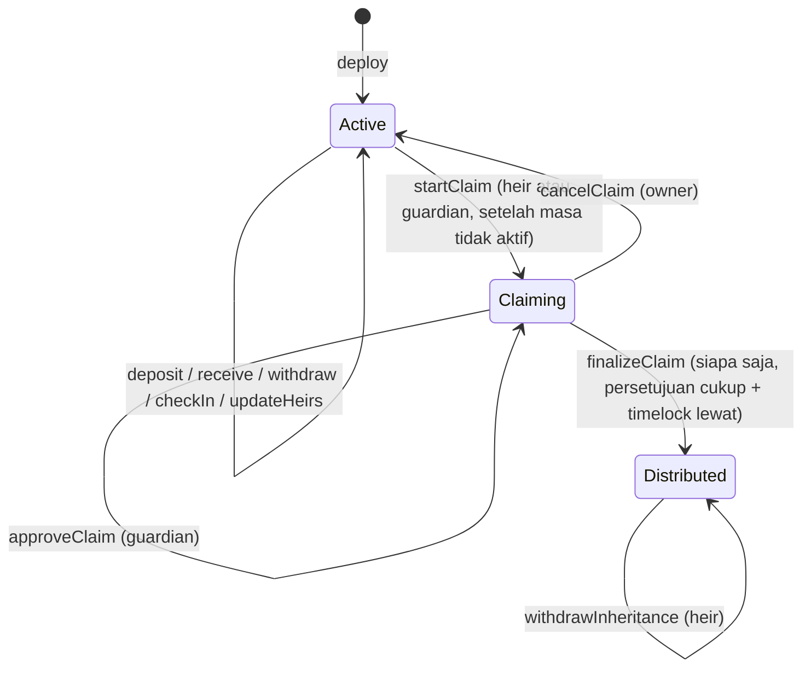
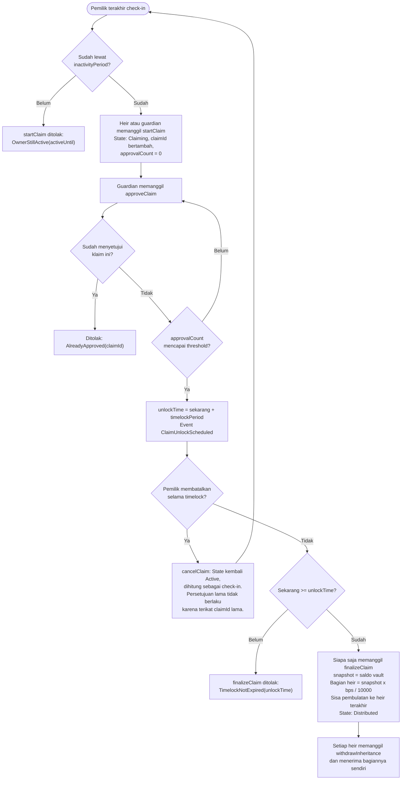

# Arsitektur LegacyVault

Dokumen ini menggambarkan bagian-bagian sistem dan hubungannya. Aturan desain lengkapnya ada di [SPEC.md](../SPEC.md).

## 1. Diagram komponen

| Komponen | Peran |
|---|---|
| UI simulasi | Halaman web untuk memilih tokoh dan menjalankan aksi. Tombol dinonaktifkan sesuai peran, tetapi aturan waktu dan state tetap ditegakkan kontrak. |
| ethers v6 (`chain.js`) | Mengubah klik tombol menjadi panggilan JSON-RPC. Setiap transaksi dicoba dulu dengan `staticCall`, supaya penolakan dari kontrak bisa diterjemahkan menjadi pesan yang mudah dibaca sebelum transaksi dikirim. |
| `contract.json` | Alamat kontrak dan ABI, ditulis otomatis setelah deploy lokal. ABI adalah "daftar menu" fungsi kontrak, sehingga UI tahu cara menyusun panggilan. |
| Anvil | Blockchain lokal untuk pengembangan. Akun-akunnya sudah terbuka, jadi UI tidak memerlukan private key. Waktu bisa dimajukan dengan `evm_increaseTime`. |
| LegacyVault | Seluruh aturan bisnis: peran, state, waktu, persetujuan, pembagian. |
| ReentrancyGuard | Satu-satunya pustaka luar yang dipakai, untuk modifier `nonReentrant`. |

Di Sepolia, susunannya sama tetapi Anvil diganti node Sepolia (melalui RPC URL dari penyedia seperti Alchemy atau Infura), dan transaksi ditandatangani dengan private key wallet testnet. UI simulasi tidak dipakai di Sepolia karena sengaja dibatasi ke chainId 31337.

## 2. Diagram state

| State | Arti | Yang bisa terjadi |
|---|---|---|
| `Active` | Pemilik dianggap aktif dan menguasai penuh dana | Setor, tarik, check-in, ubah heir, mulai klaim (jika masa tidak aktif lewat) |
| `Claiming` | Klaim warisan sedang berjalan | Guardian menyetujui, owner membatalkan, siapa saja memfinalkan jika syarat terpenuhi. Setor, tarik, check-in, dan ubah heir ditolak. |
| `Distributed` | Final, tidak bisa kembali | Heir menarik bagiannya. Setoran baru ditolak. |

Setiap fungsi memeriksa state dengan modifier `inState(...)`. Jika state tidak sesuai, kontrak membatalkan transaksi dengan error `InvalidState(expected, current)`.

## 3. Flowchart proses klaim

Catatan:

- Pemilik juga bisa membatalkan **sebelum** threshold tercapai, karena `cancelClaim` berlaku selama state `Claiming`.
- `finalizeClaim` sebelum threshold tercapai ditolak dengan `NotEnoughApprovals(approvals, threshold)`.
- Persetujuan tambahan setelah threshold tercapai tetap dihitung, tetapi tidak menggeser `unlockTime`.

## 4. Tabel fungsi dan peran

Tanda ✓ berarti peran itu boleh memanggil fungsi tersebut. Peran yang salah ditolak dengan error di kolom terakhir.

| Fungsi | Owner | Heir | Guardian | Siapa saja | State | Error jika peran salah |
|---|---|---|---|---|---|---|
| `constructor(...)` payable | (deployer menjadi owner) | | | | - | - |
| `receive()` / `deposit()` payable | ✓ (juga check-in) | ✓ | ✓ | ✓ | `Active` | - |
| `withdraw(amount)` | ✓ (juga check-in) | | | | `Active` | `NotOwner()` |
| `checkIn()` | ✓ | | | | `Active` | `NotOwner()` |
| `updateHeirs(heirs, sharesBps)` | ✓ (juga check-in) | | | | `Active` | `NotOwner()` |
| `startClaim()` | | ✓ | ✓ | | `Active` | `NotHeirOrGuardian()` |
| `approveClaim()` | | | ✓ | | `Claiming` | `NotGuardian()` |
| `cancelClaim()` | ✓ (juga check-in) | | | | `Claiming` | `NotOwner()` |
| `finalizeClaim()` | ✓ | ✓ | ✓ | ✓ | `Claiming` | - |
| `withdrawInheritance()` | | ✓ | | | `Distributed` | `NotHeir()` |
| `getStatus()` view | ✓ | ✓ | ✓ | ✓ | semua | - |

Kenapa beberapa pilihan desainnya begitu:

- **`finalizeClaim` boleh dipanggil siapa saja.** Semua syaratnya (threshold dan timelock) sudah dicek kontrak, jadi siapa pun yang memanggilnya tidak bisa mengubah hasil. Ini mencegah klaim macet hanya karena tidak ada yang mau membayar gas.
- **Guardian boleh memulai klaim.** Heir mungkin tidak tahu cara memakai wallet atau belum tahu pemilik sudah tiada. Guardian tetap tidak bisa menerima dana, karena guardian tidak boleh sekaligus menjadi heir.
- **Setoran dari selain owner tidak dihitung sebagai check-in.** Kalau dihitung, siapa saja bisa menunda klaim selamanya dengan menyetor 1 wei.

### Event

| Event | Dipancarkan oleh |
|---|---|
| `Deposited(from, amount)` | `receive`, `deposit`, constructor yang membawa ETH |
| `Withdrawn(to, amount)` | `withdraw` |
| `CheckedIn(timestamp)` | Constructor, `checkIn`, dan setiap aksi owner yang dihitung sebagai check-in (setor, `withdraw`, `updateHeirs`, `cancelClaim`) |
| `HeirsUpdated()` | `updateHeirs` |
| `ClaimStarted(claimId, initiator)` | `startClaim` |
| `ClaimApproved(claimId, guardian, approvals)` | `approveClaim` |
| `ClaimUnlockScheduled(claimId, unlockTime)` | `approveClaim` saat threshold tercapai |
| `ClaimCancelled(claimId)` | `cancelClaim` |
| `ClaimFinalized(claimId, snapshot)` | `finalizeClaim` |
| `InheritanceWithdrawn(heir, amount)` | `withdrawInheritance` |

UI membaca event-event ini untuk mengisi buku catatan.
